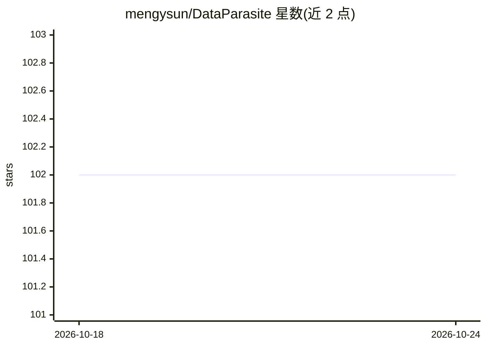

# mengysun/DataParasite

⭐ 102 · JavaScript · BSD-3-Clause · 推送 2026-10-23 · [GitHub](https://github.com/mengysun/DataParasite) · 个人维护

**面向科研的批量实体信息采集流水线：LLM 并行网页搜索+结构化输出**

用于长列表实体的可扩展在线数据采集框架：以单个 Python 脚本读取 CSV 实体列表，按 YAML 任务配置（schema、提示词、模型）并行调用 OpenAI Responses API 进行 agentic 网页搜索，输出含遥测、token 用量与成本估算的 JSONL 及清洗后 CSV。设计为供编码 agent（如 Cursor-agent CLI、Codex CLI）端到端编排，也可人工运行 CLI 或用 ChatGPT 网页版起草配置；联网 agent 可在线自建实体列表实现零输入启动。已知限制：结果中的 URL 引用可能不精确或失效。附 arXiv 论文与示例任务模板。

## 筛选速览

| 维度 | 判定 | 备注 |
|---|---|---|
| AI 角色 | `ai-native` | 本体是模型或模型工具 |
| 许可风险 | `permissive` | BSD-3-Clause |
| 部署形态 | `library` | 以包/库形式分发 |
| 模型依赖 | — | README 未给出锁定关系 |
| 硬件要求 | — | 无带数字的原话,不猜 |
| 安装摩擦 | `low` | 无编译、无系统依赖或容器化 |
| 成熟度 | — | 结构信号不足 |

## 能力要点

- 单脚本+YAML 配置实现实体级并行 agentic 搜索
- 支持编码 agent 端到端编排或纯手动 CLI 流程
- 零输入引导：联网 agent 可在线自建实体列表
- JSONL 输出记录 token 用量、成本与时间，便于审计

## 适用场景

- 批量采集大量学者/人物等实体的结构化信息
- 让编码 agent 端到端代为起草配置并执行采集
- 科学学研究中的长列表数据收集与复现实验

## 场景标签

`科研工具` `网页抓取` · 领域:效率与自动化

## 证据(README 行号)

> L5: DataParasite is a simple yet versatile context engineered for scalable online data collection with LLMs. The project
> L14: - A single Python script that performs parallel agentic web search based on a CSV input
> L60: The default model is `gpt-6-luna` for affordable, high-volume collection. Use `--model gpt-6-sol` or `--model gpt-6

## 星数曲线

2026-10-18 102 → 2026-10-24 102（+0）

---
*卡片 v1 · prompt 1.4 · 生成 2026-10-23 · 置信度 high · 依据 README sha `6f642bae777d` · [字段定义](../../DATASET.md)*
