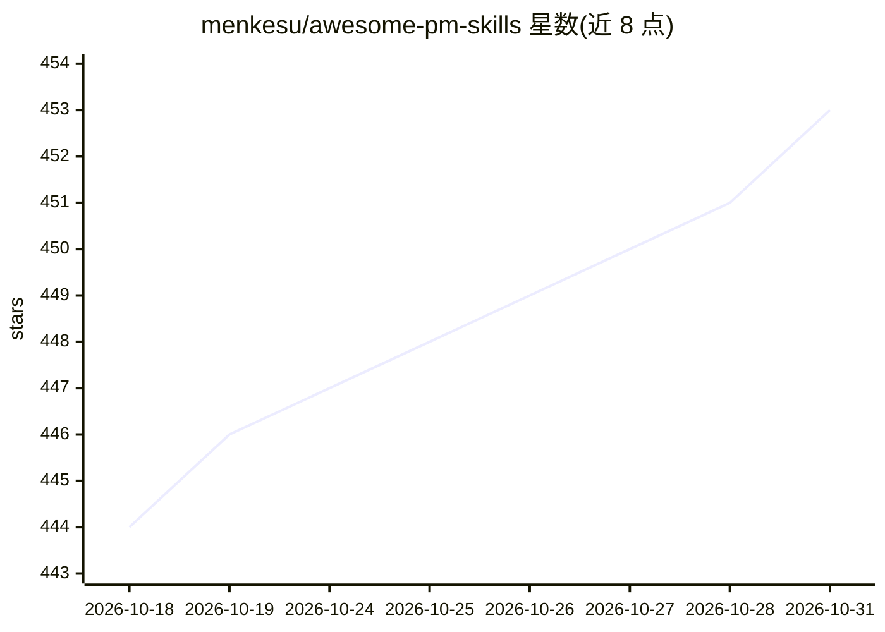

# menkesu/awesome-pm-skills

⭐ 453 · Python · NOASSERTION · 推送 2026-10-06 · [GitHub](https://github.com/menkesu/awesome-pm-skills) · [官网](https://genaipm.com) · 个人维护

**产品经理工作流技能集：25 个基于播客内容的 AI 技能文件**

基于 Lenny's Podcast 340 期节目内容构建的 25 个产品管理工作流技能（SKILL.md 格式），覆盖定价、规格、用户访谈、优先级、AI 评测、增长等场景。每个技能包含情境诊断、框架路由、执行步骤、专家分歧说明、交付物模板与评分标准，引文均带嘉宾归属与时间戳并可脚本核对。以 Claude Code 插件形式安装，也可复制技能目录用于 Codex、Cursor 或其他助手，本体无需 API key 或外部服务。

## 筛选速览

| 维度 | 判定 | 备注 |
|---|---|---|
| AI 角色 | `ai-knowledge` | 知识聚合/清单类 |
| 许可风险 | `none` | NOASSERTION |
| 部署形态 | `library` | 以包/库形式分发 |
| 模型依赖 | locked-api |  |
| 硬件要求 | — | 无带数字的原话,不猜 |
| 安装摩擦 | `low` | 无编译、无系统依赖或容器化 |
| 成熟度 | — | 结构信号不足 |

## 能力要点

- 25 个技能来自 340 期播客语料与 10,567 条提取洞见
- 978 条引文经脚本核对，带归属与时间戳
- 每个技能含诊断、框架路由、交付物模板与评分 rubric
- 支持 Claude Code 插件、手动复制到 Codex/Cursor 技能目录两种用法

## 适用场景

- 让 Claude Code/Codex/Cursor 代写定价方案、PRD、决策备忘录等产品交付物
- 对已有的定价页或规格文档做评分与改进建议
- 按工作场景（访谈、优先级、实验、增长）查找对应的工作流技能

## 场景标签

`精选清单` `提示工程` · 领域:Agent 开发

## 证据(README 行号)

> L3: **25 product management workflows built from 340 episodes of Lenny’s Podcast.**
> L35: /plugin marketplace add menkesu/awesome-pm-skills
> L85: - **Context first.** Stage, customer, goal, and constraints route you to an appropriate framework.

## 星数曲线

2026-10-18 444 → 2026-10-31 453（+9）

---
*卡片 v1 · prompt 1.4 · 生成 2026-10-21 · 置信度 mid · 依据 README sha `60835627f478` · [字段定义](../../DATASET.md)*
