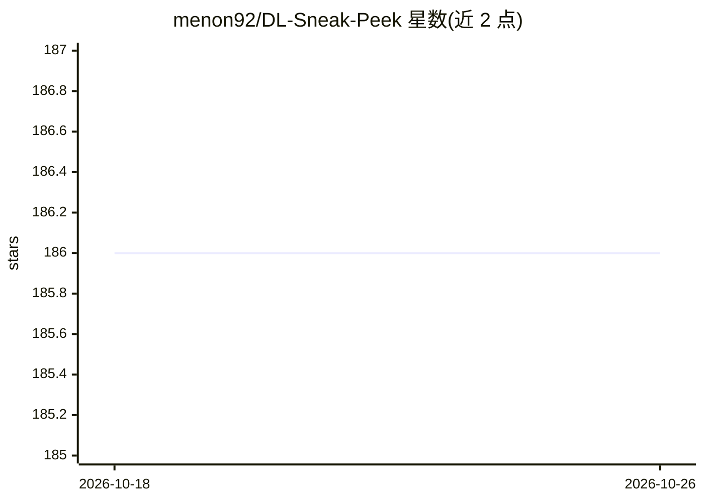

# menon92/DL-Sneak-Peek

⭐ 186 · Jupyter Notebook · Apache-2.0 · 推送 2026-07-05 · [GitHub](https://github.com/menon92/DL-Sneak-Peek) · 个人维护

**孟加拉语深度学习/机器学习教程与资源清单**

个人维护的学习笔记与资源汇编：以孟加拉语撰写 TensorFlow/Keras 基础、梯度带、线性回归等入门教程（附 notebook 与 Colab 链接），并按计算机视觉、音频/语音、LLM、NLP、模型部署、MLOps、CNN/RNN/Transformer、课程、书籍等类别汇总英文与孟加拉语外部链接。内容为讲解性文章与链接列表，不提供可安装的软件包或 API。

## 筛选速览

| 维度 | 判定 | 备注 |
|---|---|---|
| AI 角色 | `ai-knowledge` | 知识聚合/清单类 |
| 许可风险 | `permissive` | Apache-2.0 |
| 部署形态 | `None` |  |
| 模型依赖 | — | README 未给出锁定关系 |
| 硬件要求 | — | 无带数字的原话,不猜 |
| 安装摩擦 | `low` | 无编译、无系统依赖或容器化 |
| 成熟度 | — | 结构信号不足 |

## 能力要点

- 孟加拉语撰写的 TensorFlow/Keras 基础与数据管道教程（附 notebook 与 Colab）
- 覆盖 CV、音频/语音、LLM、NLP、MLOps、部署等主题分类
- 收录孟加拉语 ML/DL 本地化学习资源与英文课程/书籍清单

## 适用场景

- 用孟加拉语系统学习 TensorFlow 与深度学习基础
- 查找图像数据管道、音频特征、LLM 微调等主题的教程链接
- 按分类浏览 ML 课程、书籍与 MLOps 资料

## 场景标签

`教程课程` `精选清单` · 领域:学习与行业

## 证据(README 行号)

> L2: I try to explain various important terms of deep learning and machine learning.
> L3: I will write this sort of tutorial for helping myself to build a clear understanding.
> L7: |Part|Topic|Git|Colab|

## 星数曲线

2026-10-18 186 → 2026-10-26 186（+0）

---
*卡片 v1 · prompt 1.4 · 生成 2026-10-22 · 置信度 high · 依据 README sha `355e0d92906d` · [字段定义](../../DATASET.md)*
