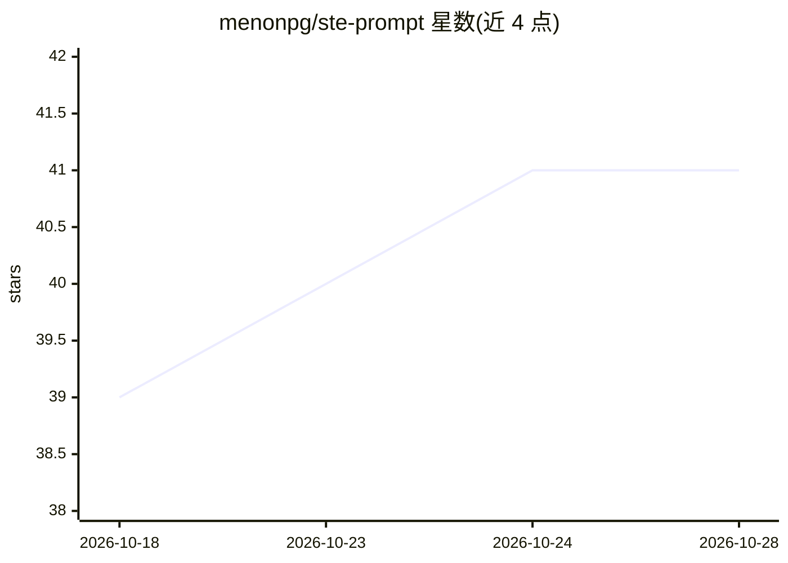

# menonpg/ste-prompt

⭐ 41 · MIT · 推送 2026-10-09 · [GitHub](https://github.com/menonpg/ste-prompt) · 个人维护

**让编码 agent 用简化技术英语（ASD-STE100）写作的规则插件**

面向 Claude Code、Codex 等编码 agent 的提示词/插件资产：提供 ASD-STE100 简化技术英语的 10 条规则、RULES.md 全量规则与 DICTIONARY.md 批准词汇表，通过 /ste 斜杠命令、skill、output-style 或 AGENTS.md 追加等方式让 agent 产出短句、主动语态、受控词汇的解释、runbook 与操作步骤。支持 Claude Code 插件市场安装、手动文件复制及任何读取 AGENTS.md 约定的 agent（Cursor、Cline、Aider 等）。README 明确不适用于需要模糊表述的场景（风险讨论、研究综述）。

## 筛选速览

| 维度 | 判定 | 备注 |
|---|---|---|
| AI 角色 | `ai-ecosystem` | LLM/agent 周边工具 |
| 许可风险 | `permissive` | MIT |
| 部署形态 | `None` |  |
| 模型依赖 | locked-api |  |
| 硬件要求 | — | 无带数字的原话,不猜 |
| 安装摩擦 | `low` | 无编译、无系统依赖或容器化 |
| 成熟度 | — | 结构信号不足 |

## 能力要点

- 提供 /ste 斜杠命令与 simplified-technical-english skill 按需或自动改写输出
- 10 条 STE 规则 + RULES.md 全量规则 + DICTIONARY.md 批准动词替换表
- AGENTS.md 追加方式兼容 Codex、Cursor、Cline、Aider 等任意读取该约定的 agent
- Claude Code 插件市场一键安装，也支持纯提示词粘贴无需安装

## 适用场景

- 让编码 agent 生成的 runbook 和操作步骤更易快速阅读、减少歧义
- 团队统一 agent 产出的技术文档风格（短句、主动语态、受控词汇）
- 在 Codex/Cursor 等工具中通过 AGENTS.md 持久化 STE 写作规范

## 场景标签

`提示工程` `AI 写作` · 领域:Agent 开发

## 证据(README 行号)

> L5: STE-Prompt makes Claude Code, Codex, and other agents write explanations,
> L28: This repo is a Claude Code plugin **and** a one-plugin marketplace. Install it
> L62: **Option 1 — `AGENTS.md` (recommended).** Codex automatically reads `AGENTS.md`

## 星数曲线

2026-10-18 39 → 2026-10-28 41（+2）

---
*卡片 v1 · prompt 1.4 · 生成 2026-10-25 · 置信度 high · 依据 README sha `2b4114da2f41` · [字段定义](../../DATASET.md)*
