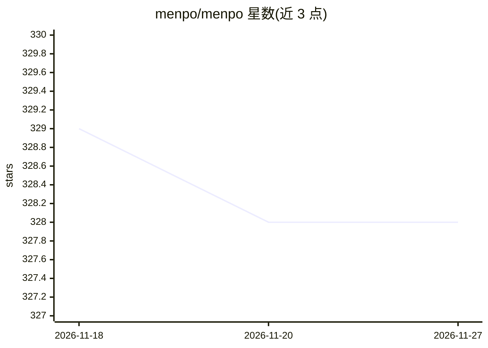

# menpo/menpo

⭐ 328 · Python · BSD-3-Clause · 推送 2026-11-25 · [GitHub](https://github.com/menpo/menpo) · [官网](http://www.menpo.org) · 组织维护

**给 CV/ML 研究者处理标注图像与网格数据的 Python 工具库**

Menpo 项目核心库，面向机器学习与计算机视觉领域常见的标注数据：导入、操作与可视化图像和网格数据，所有核心类型均可携带 landmarks（标注点），支持基于标注点的图像掩膜、裁剪与对齐。定位为在 ML/CV 领域实现算法的基础库，配套 menpofit（可变形模型）、menpo3d（3D 网格）、menpodetect（目标检测封装）等派生库；安装推荐 conda，也支持 pip；Python 3.10+；部分功能依赖可选包（menpo3d、cyvlfeat、opencv）。

## 筛选速览

| 维度 | 判定 | 备注 |
|---|---|---|
| AI 角色 | `ai-ecosystem` | LLM/agent 周边工具 |
| 许可风险 | `permissive` | BSD-3-Clause |
| 部署形态 | `library` | 以包/库形式分发 |
| 模型依赖 | — | README 未给出锁定关系 |
| 硬件要求 | — | 无带数字的原话,不猜 |
| 安装摩擦 | `low` | 无编译、无系统依赖或容器化 |
| 成熟度 | — | 结构信号不足 |

## 能力要点

- 所有核心类型均为 Landmarkable，标注点为一等公民
- 基于标注点的图像掩膜、裁剪与图像对齐操作
- conda-forge 安装无需编译，兼容 pip
- 配套 menpofit/menpo3d/menpodetect 派生库

## 适用场景

- 导入并可视化带标注点的图像与网格数据
- 按标注点做图像裁剪、掩膜和对齐预处理
- 作为基础库实现自己的 ML/CV 算法
- 通过 Jupyter 笔记本学习各项功能

## 场景标签

`图像视频处理` · 领域:感知与多模态

## 证据(README 行号)

> L8: Menpo. The Menpo Project Python package for handling annotated data.
> L13: we focus on **annotated** data which is common within the fields of Machine
> L72: Menpo is designed to be a core library for implementing algorithms within

## 星数曲线

2026-11-18 329 → 2026-11-27 328（-1）

---
*卡片 v1 · prompt 1.4 · 生成 2026-11-25 · 置信度 high · 依据 README sha `134b0f377ead` · [字段定义](../../DATASET.md)*
