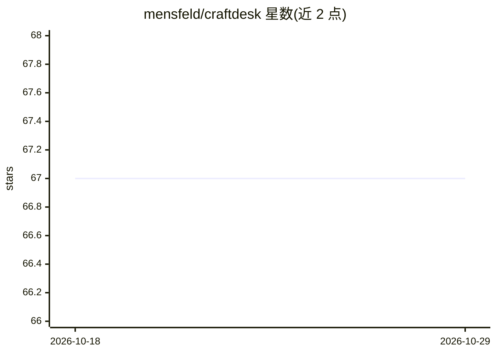

# mensfeld/craftdesk

⭐ 67 · TypeScript · 推送 2026-10-28 · [GitHub](https://github.com/mensfeld/craftdesk) · [官网](http://craftdesk.ai/) · 个人维护

**面向 Claude Code 的 AI 技能/Agent 包管理器**

CraftDesk CLI 是一个 Node.js 命令行工具，为 Claude Code 等 AI 开发环境中的 skills、agents、commands、hooks 与 plugins 提供依赖管理：从 git 仓库或 registry 安装、生成 craftdesk.json 与 lock 文件锁定版本、递归安装依赖、支持 monorepo 子目录提取与 GitHub URL 自动转换。技能以 .claude/skills/ 为规范位置，通过 SHA-256 校验和的拷贝方式同步到 Cursor、Windsurf、Continue.dev 等目录，并可转换为各编辑器格式。自托管 registry 服务器开发中，尚未提供私有 registry。

## 筛选速览

| 维度 | 判定 | 备注 |
|---|---|---|
| AI 角色 | `ai-ecosystem` | LLM/agent 周边工具 |
| 许可风险 | `permissive` | — |
| 部署形态 | `self-host` | docker 或自建部署 |
| 模型依赖 | — | README 未给出锁定关系 |
| 硬件要求 | — | 无带数字的原话,不猜 |
| 安装摩擦 | `low` | 无编译、无系统依赖或容器化 |
| 成熟度 | — | 结构信号不足 |

## 能力要点

- 从 git 仓库/registry 安装 skills、agents、commands、hooks、plugins 并递归解析依赖
- craftdesk.json + lock 文件的版本锁定与可复现环境
- 多 AI 助手同步：拷贝式同步到 Claude/Cursor/Windsurf/Continue，SHA-256 漂移检测
- crafts 转换为 Cursor (.mdc)、Continue 等编辑器格式

## 适用场景

- 团队统一管理 Claude Code 技能与 Agent 的版本和依赖
- 同一套 skills 在 Claude Code、Cursor、Windsurf 等多个 AI 编辑器间共享
- 把项目专属技能提交进 git 仓库与托管依赖混合管理

## 场景标签

 · 领域:AI 开发工具/包管理

## 证据(README 行号)

> L3: > **Dependency management for AI capabilities** - Install, manage, and version control your Claude Code skills, agen
> L13: CraftDesk is a package manager for AI capabilities used in Claude Code and other AI development environments. It al
> L18: - **Multi-agent sync** - Share skills across multiple AI assistants (Claude, Cursor, Windsurf, etc.)

## 星数曲线

2026-10-18 67 → 2026-10-29 67（+0）

---
*卡片 v1 · prompt 1.4 · 生成 2026-10-24 · 置信度 mid · 依据 README sha `95d1350fae57` · [字段定义](../../DATASET.md)*
