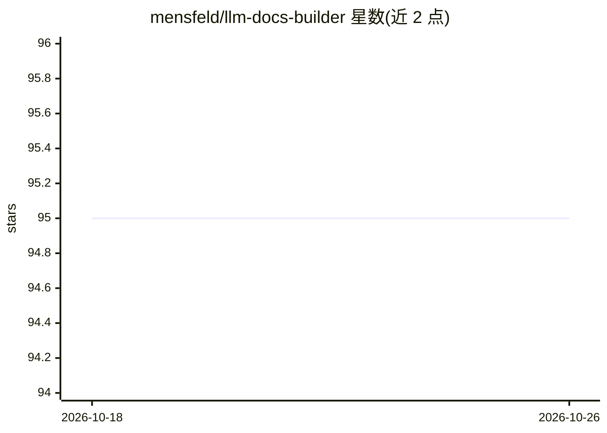

# mensfeld/llm-docs-builder

⭐ 95 · Ruby · MIT · 推送 2026-10-25 · [GitHub](https://github.com/mensfeld/llm-docs-builder) · 个人维护

**为 LLM/RAG 优化 Markdown 文档并生成 llms.txt 的 Ruby 工具**

面向文档维护者的 Ruby CLI 工具：将 Markdown/HTML 文档转换为 AI 友好格式，提供链接规范化、frontmatter/徽章/重复段落等内容移除选项，按官方说明可减少 67-95% token 消耗；支持层级化标题上下文（RAG 分块保留完整上下文）、生成带 token 计数/时间戳/优先级元数据的 llms.txt，并按优先级分节组织。提供 Docker 镜像与 RubyGems 安装，含 compare/transform/bulk-transform/generate 命令，可配合 Apache/Nginx 按 User-Agent 向 AI 爬虫分发优化版本。

## 筛选速览

| 维度 | 判定 | 备注 |
|---|---|---|
| AI 角色 | `ai-ecosystem` | LLM/agent 周边工具 |
| 许可风险 | `permissive` | MIT |
| 部署形态 | `self-host` | docker 或自建部署 |
| 模型依赖 | — | README 未给出锁定关系 |
| 硬件要求 | — | 无带数字的原话,不猜 |
| 安装摩擦 | `low` | 无编译、无系统依赖或容器化 |
| 成熟度 | — | 结构信号不足 |

## 能力要点

- HTML 到 Markdown 自动转换（表格、代码块、图片等）
- 层级化标题规范化使 RAG 分块自含上下文
- llms.txt 增强元数据（token 计数、时间戳、优先级、压缩比）
- compare 命令测量人类版与 AI 版文档的 token 差异

## 适用场景

- 优化项目文档以减少 LLM 抓取时的 token 消耗
- 为 RAG 系统准备带完整标题上下文的分块友好文档
- 自动生成符合规范的 llms.txt 索引并通过 Web 服务器分发给 AI 爬虫

## 场景标签

`文档解析` · 领域:知识与检索

## 证据(README 行号)

> L10: llm-docs-builder transforms markdown documentation to be AI-friendly and generates llms.txt files. It normalizes li
> L188: ### Heading Normalization
> L220: Generate enriched llms.txt files with token counts, timestamps, and priority labels to help AI agents make better 

## 星数曲线

2026-10-18 95 → 2026-10-26 95（+0）

---
*卡片 v1 · prompt 1.4 · 生成 2026-10-23 · 置信度 high · 依据 README sha `7f890d7202c8` · [字段定义](../../DATASET.md)*
