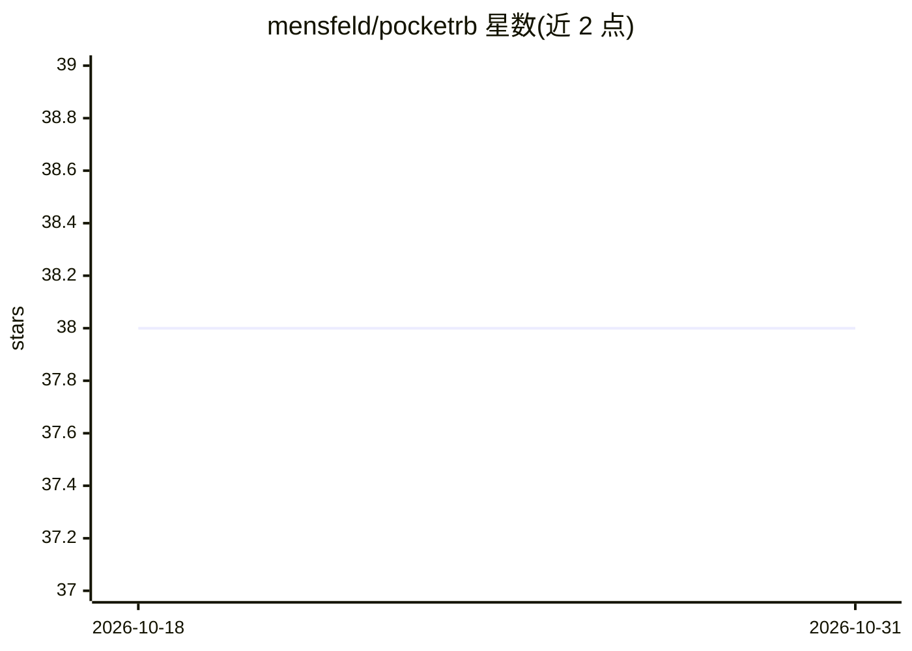

# mensfeld/pocketrb

⭐ 38 · Ruby · MIT · 推送 2026-10-30 · [GitHub](https://github.com/mensfeld/pocketrb) · 个人维护

**面向 Ruby 开发者的轻量多 LLM agent 框架与助手**

用 Ruby 编写的 AI agent 框架，提供多 LLM 接入（Anthropic API、Claude Max OAuth/Proxy、Claude CLI、OpenRouter、OpenAI 兼容 API、RubyLLM）与多渠道（CLI、Telegram、WhatsApp 桥接）。内置文件操作、shell 执行、浏览器自动化（无头 Chromium）、cron 调度等工具，采用 JSON 关键词匹配的无外部依赖记忆系统、SKILL.md 技能体系与自动上下文压缩（40 条消息或约 5 万 token 后触发摘要）。以 gem 形式分发，MIT 许可。

## 筛选速览

| 维度 | 判定 | 备注 |
|---|---|---|
| AI 角色 | `ai-ecosystem` | LLM/agent 周边工具 |
| 许可风险 | `permissive` | MIT |
| 部署形态 | `None` |  |
| 模型依赖 | locked-api |  |
| 硬件要求 | — | 无带数字的原话,不猜 |
| 安装摩擦 | `low` | 无编译、无系统依赖或容器化 |
| 成熟度 | — | 结构信号不足 |

## 能力要点

- 多 LLM provider：Anthropic、OpenRouter、OpenAI 兼容 API、RubyLLM、Claude CLI 等
- CLI / Telegram / WhatsApp 三种使用渠道及 Gateway 聚合模式
- 无外部依赖的 JSON 记忆系统（关键词匹配，无需向量库）
- SKILL.md 运行时技能体系，agent 可在运行时创建新技能

## 适用场景

- 通过 Telegram/WhatsApp 部署个人 AI 助手并定时执行任务
- 在 Ruby 项目中构建带工具调用与记忆的 LLM agent
- 用无头 Chromium 做浏览器自动化与网页抓取

## 场景标签

`Agent 框架` `AI 助手` · 领域:Agent 开发

## 证据(README 行号)

> L7: A pocket-sized Ruby AI agent framework with multi-LLM support and advanced capabilities.
> L12: - **Multi-LLM support**: Claude (API + Max/OAuth + Proxy), OpenRouter, OpenAI-compatible APIs, RubyLLM, Claude CLI
> L229: ## Providers

## 星数曲线

2026-10-18 38 → 2026-10-31 38（+0）

---
*卡片 v1 · prompt 1.4 · 生成 2026-10-25 · 置信度 high · 依据 README sha `b322ef0cfc54` · [字段定义](../../DATASET.md)*
