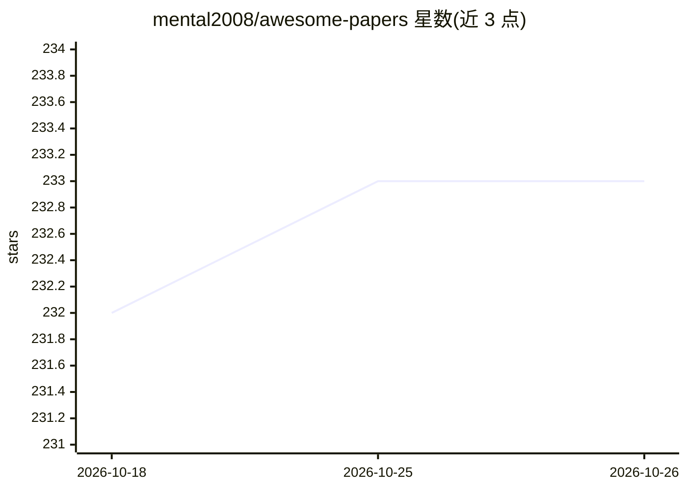

# mental2008/awesome-papers

⭐ 233 · JavaScript · MIT · 推送 2026-10-06 · [GitHub](https://github.com/mental2008/awesome-papers) · [官网](https://paper.lingyunyang.com/) · 个人维护 · 中文 README

**个人学术论文阅读笔记库：ML 系统与 AI 基础设施**

由阿里巴巴 AI 基础设施资深工程师（HKUST 博士）维护的个人论文阅读笔记仓库：收录系统方向（OSDI、SOSP、NSDI、ATC、EuroSys、SoCC、ASPLOS、MLSys）与机器学习方向（ICML、ICLR、NeurIPS）论文的笔记，按主题（如 systems for ML）与会议/期刊日期分类组织。读者可通过 issue 请求补充论文讨论或提交 PR 修正，笔记可在网站阅读。以 MIT 许可发布。

## 筛选速览

| 维度 | 判定 | 备注 |
|---|---|---|
| AI 角色 | `ai-knowledge` | 知识聚合/清单类 |
| 许可风险 | `permissive` | MIT |
| 部署形态 | `None` |  |
| 模型依赖 | — | README 未给出锁定关系 |
| 硬件要求 | — | 无带数字的原话,不猜 |
| 安装摩擦 | `low` | 无编译、无系统依赖或容器化 |
| 成熟度 | — | 结构信号不足 |

## 能力要点

- 覆盖 OSDI/SOSP/NSDI/MLSys 等系统会议与 ICML/ICLR/NeurIPS 论文的阅读笔记
- 按主题与会议/期刊日期双重分类组织
- 支持通过 issue 请求论文讨论与 PR 修正

## 适用场景

- 查找 ML 系统与 AI 基础设施方向的论文笔记
- 按会议/时间线追踪系统领域研究脉络
- 通过 issue 与维护者讨论感兴趣的论文

## 场景标签

`精选清单` · 领域:学习与行业

## 证据(README 行号)

> L9: This space hosts my personal notes on academic papers. My interests span systems (e.g., OSDI, SOSP, NSDI, ATC, EuroS
> L16: 2. I've organized a list of papers on several topics (e.g., systems for ML) and also categorized the reading notes 

## 星数曲线

2026-10-18 232 → 2026-10-26 233（+1）

---
*卡片 v1 · prompt 1.4 · 生成 2026-10-22 · 置信度 high · 依据 README sha `bfd977066224` · [字段定义](../../DATASET.md)*
