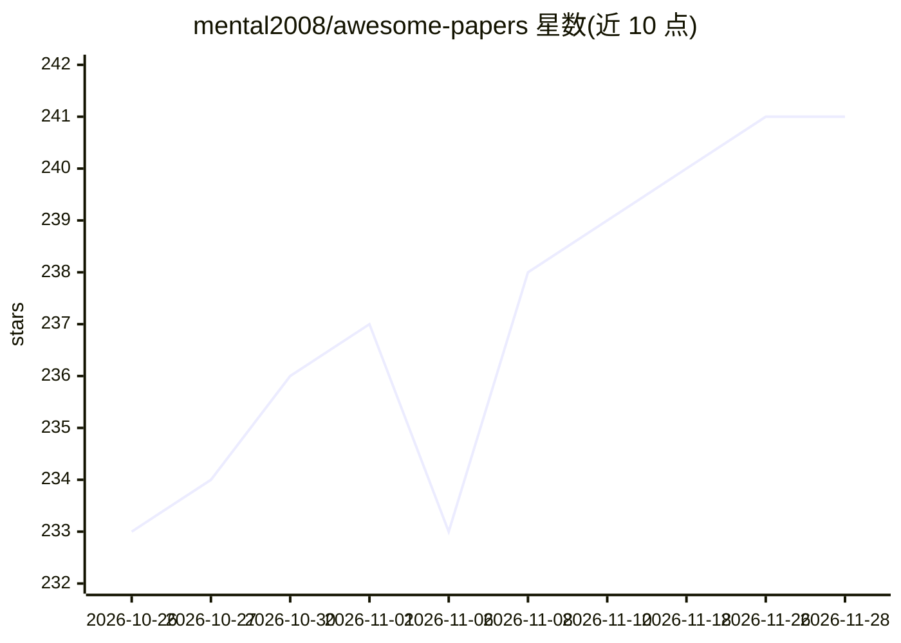

# mental2008/awesome-papers

⭐ 241 · JavaScript · MIT · 推送 2026-11-20 · [GitHub](https://github.com/mental2008/awesome-papers) · [官网](https://paper.lingyunyang.com/) · 个人维护

**个人论文阅读笔记仓库：ML 系统与 AI 基础设施方向**

阿里巴巴高级工程师（HKUST 博士）维护的个人学术论文阅读笔记仓库，覆盖系统会议（OSDI、SOSP、NSDI、EuroSys、MLSys 等）与机器学习会议（ICML、ICLR、NeurIPS）的论文。按主题（如 ML 系统）与会议/期刊日期组织笔记列表，不定期更新，配套网页阅读站点。读者可通过 issue 与作者交流感兴趣的论文，或提交 PR 修正笔误。MIT 许可发布。

## 筛选速览

| 维度 | 判定 | 备注 |
|---|---|---|
| AI 角色 | `ai-knowledge` | 知识聚合/清单类 |
| 许可风险 | `permissive` | MIT |
| 部署形态 | `None` |  |
| 模型依赖 | — | README 未给出锁定关系 |
| 硬件要求 | — | 无带数字的原话,不猜 |
| 安装摩擦 | `low` | 无编译、无系统依赖或容器化 |
| 成熟度 | — | 结构信号不足 |

## 能力要点

- 系统与机器学习方向的学术论文阅读笔记
- 按主题与会议/期刊日期分类组织
- 配套网页站点阅读，支持 issue 讨论与 PR 贡献

## 适用场景

- 查找 ML 系统、AI 基础设施方向的论文笔记
- 按会议线索梳理 OSDI/MLSys 等会议论文
- 向作者推荐论文并交流看法

## 场景标签

`精选清单` · 领域:学习与行业

## 证据(README 行号)

> L9: This space hosts my personal notes on academic papers. My interests span systems (e.g., OSDI, SOSP, NSDI, ATC, EuroS
> L16: 2. I've organized a list of papers on several topics (e.g., systems for ML) and also categorized the reading notes 

## 星数曲线

2026-10-26 233 → 2026-11-28 241（+8）

---
*卡片 v1 · prompt 1.4 · 生成 2026-11-25 · 置信度 high · 依据 README sha `cddef7761488` · [字段定义](../../DATASET.md)*
