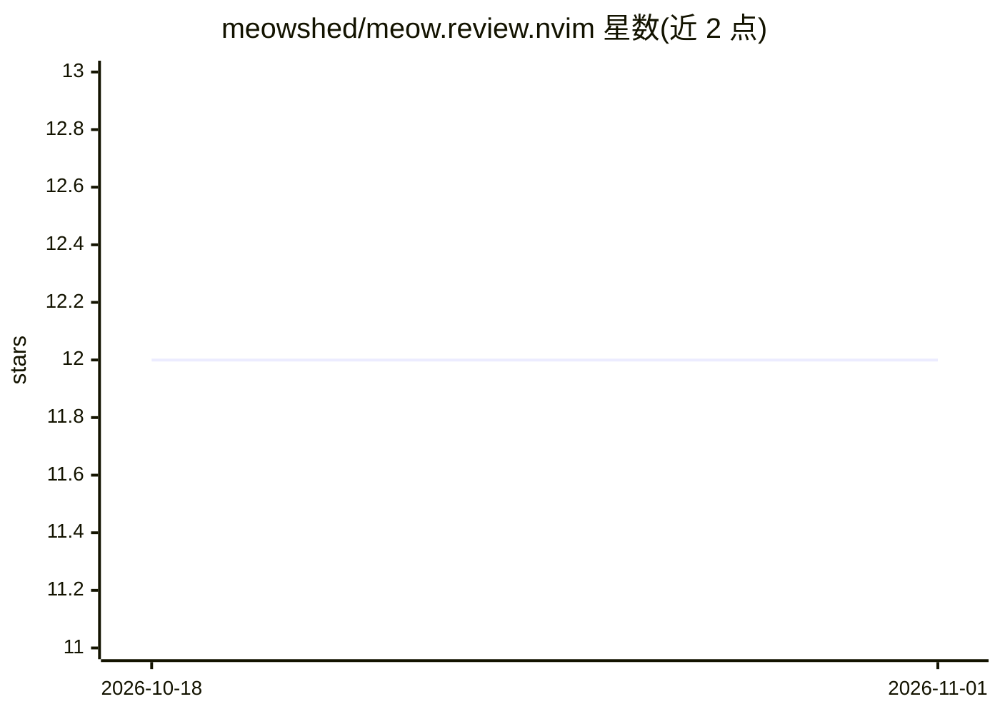

# meowshed/meow.review.nvim

⭐ 12 · Lua · MIT · 推送 2026-10-26 · [GitHub](https://github.com/meowshed/meow.review.nvim) · [官网](https://github.com/retran/meow.review.nvim) · 个人维护

**Neovim 代码批注插件：持久化审阅注释并导出给 AI agent**

在 Neovim 中添加类型化（ISSUE/SUGGESTION/NOTE）、持久的行内审阅注释，注释附带 Treesitter 符号名与 git hunk 关联，以 JSON 存储并支持重启后恢复、位置漂移跟踪与失效检测。注释可导出为面向 AI agent 消费的结构化 Markdown（含机器可解析的文件分节与上下文代码），内置 clipboard/file/file_prompt 导出器，可注册自定义导出器；检测到 avante.nvim / codecompanion.nvim 时自动注册导出通道，另附 zellij+opencode 示例。面向使用 Neovim 并搭配 AI agent 进行开发的用户。

## 筛选速览

| 维度 | 判定 | 备注 |
|---|---|---|
| AI 角色 | `ai-enhanced` | 去掉 AI 部分产品仍成立 |
| 许可风险 | `permissive` | MIT |
| 部署形态 | `None` |  |
| 模型依赖 | — | README 未给出锁定关系 |
| 硬件要求 | — | 无带数字的原话,不猜 |
| 安装摩擦 | `low` | 无编译、无系统依赖或容器化 |
| 成熟度 | — | 结构信号不足 |

## 能力要点

- 类型化注释（ISSUE/SUGGESTION/NOTE）+ JSON 持久化 + 位置漂移跟踪（extmarks）
- 导出为机器可解析的结构化 Markdown，供 AI agent 消费
- 可插拔导出器与格式化器注册机制；avante.nvim/codecompanion.nvim 检测到即自动注册
- 注释失效检测、resolve 状态、跨文件导航与 statusline 集成

## 适用场景

- 在 Neovim 中对 AI 生成代码留下持久化审阅注释并跟踪其状态
- 把审阅意见导出为 Markdown 交给 avante/codecompanion/opencode 等 agent 处理
- 在代码评审中跨文件导航与管理注释，导出后一键清空

## 场景标签

 · 领域:开发者工具/编辑器插件

## 证据(README 行号)

> L12:  meow.review.nvim — Annotate Code, Guide Your AI
> L30: - **avante.nvim / codecompanion.nvim** — auto-registered exporters when those plugins are detected
> L291: The Markdown is structured for AI agent consumption — each file gets a `## @file` section, and each annotation hea

## 星数曲线

2026-10-18 12 → 2026-11-01 12（+0）

---
*卡片 v1 · prompt 1.4 · 生成 2026-11-01 · 置信度 high · 依据 README sha `f2defea231b3` · [字段定义](../../DATASET.md)*
