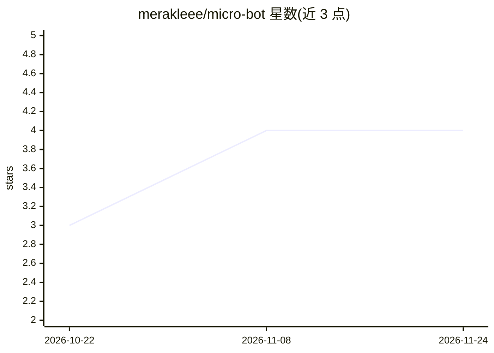

# merakleee/micro-bot

⭐ 4 · Python · 推送 2026-10-17 · [GitHub](https://github.com/merakleee/micro-bot) · 个人维护

**MicroClub 社团的文档 RAG 问答机器人**

面向 MicroClub 的文档问答 API 服务：摄取 Markdown/PDF/DOCX（扫描件经 OCRmyPDF 与 Tesseract 提取文本），按结构感知切块后用 multilingual-e5-small 嵌入，存入 Qdrant 并支持公开/成员可见性过滤；回答经 OpenRouter 生成并附带来源，检索相关性不足时声明不知道。SQLite 记录文档元数据，日志记录请求 ID、延迟、grounding 状态与 token 用量。提供 Docker Compose 或本地 Python 两种运行方式，默认配置含每日 50 次 LLM 调用限制与 10 MiB 上传上限。

## 筛选速览

| 维度 | 判定 | 备注 |
|---|---|---|
| AI 角色 | `ai-native` | 本体是模型或模型工具 |
| 许可风险 | `none` | — |
| 部署形态 | `desktop` | 安装包/桌面程序 |
| 模型依赖 | locked-api |  |
| 硬件要求 | — | 无带数字的原话,不猜 |
| 安装摩擦 | `low` | 无编译、无系统依赖或容器化 |
| 成熟度 | — | 结构信号不足 |

## 能力要点

- 检索-生成式问答返回来源与 grounding 状态，无相关上下文时拒绝作答
- 文档可见性过滤（public/members）+ 成员 Bearer token 分级访问
- 支持扫描 PDF 的 OCR 提取与结构感知重叠切块
- 结构化日志记录延迟、grounding 状态与 token 用量

## 适用场景

- 为学生社团搭建文档知识库问答
- 对公开与成员内容做权限分级的文档检索
- 需要回答可溯源的内部文档助手

## 场景标签

`文档问答` · 领域:知识与检索

## 证据(README 行号)

> L3: MicroBot is a document-grounded assistant for MicroClub. It retrieves relevant passages from an ingested corpus, sen
> L10: - Embed document passages and user questions with `intfloat/multilingual-e5-small` using Sentence Transformers.
> L12: - Generate grounded responses through OpenRouter. The repository currently configures `google/gemma-4-31b-it:free` 

## 星数曲线

2026-10-22 3 → 2026-11-24 4（+1）

---
*卡片 v1 · prompt 1.4 · 生成 2026-11-21 · 置信度 high · 依据 README sha `88a431d7db6b` · [字段定义](../../DATASET.md)*
