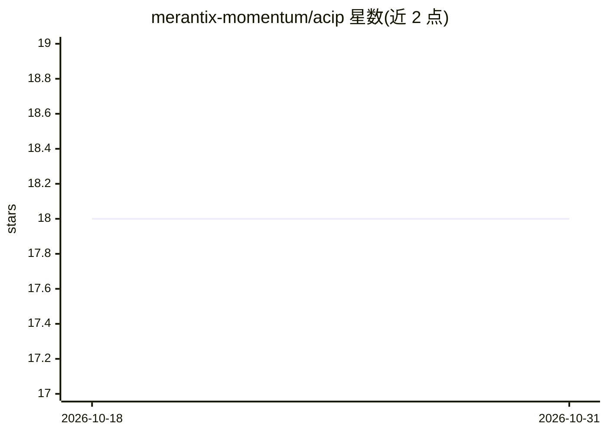

# merantix-momentum/acip

⭐ 18 · Python · NOASSERTION · 推送 2026-02-11 · [GitHub](https://github.com/merantix-momentum/acip) · [官网](https://arxiv.org/abs/2502.01717) · 组织维护

**LLM 迭代剪枝压缩算法 ACIP 的官方实现**

Merantix Momentum 开发的 ACIP（Adaptive Compression by Iterative Pruning）官方代码库：通过单次梯度下降过程对基础语言模型进行迭代剪枝，产出可在任意压缩率间反复调节的参数化模型，最终以 compress() 落地压缩并支持 4bit 量化。提供已压缩的 Llama2-7B 模型（Hugging Face Hub），可 3 行代码加载使用；也可对自有模型运行压缩、LoRA 微调与评测入口，配置基于 Hydra，训练基于 PyTorch Lightning。面向需要压缩/微调大模型的研究与工程用户。

## 筛选速览

| 维度 | 判定 | 备注 |
|---|---|---|
| AI 角色 | `ai-ecosystem` | LLM/agent 周边工具 |
| 许可风险 | `none` | NOASSERTION |
| 部署形态 | `None` |  |
| 模型依赖 | — | README 未给出锁定关系 |
| 硬件要求 | — | 无带数字的原话,不猜 |
| 安装摩擦 | `low` | 无编译、无系统依赖或容器化 |
| 成熟度 | — | 结构信号不足 |

## 能力要点

- prune_model_by_score 可反复调节任意压缩率，compress() 后实际压缩降低内存占用
- 支持 bitsandbytes 4bit 量化进一步节省内存
- 提供 acip_compress / acip_finetune / acip_eval 三个入口，覆盖压缩、LoRA 微调与评测
- Hub 上提供现成 ACIP 模型，仅需 torch/transformers/peft 最小依赖即可加载

## 适用场景

- 用 3 行代码加载现成 ACIP 模型并按目标压缩率剪枝
- 对自有 LLM 运行 ACIP 算法生成可剪枝版本并压缩
- 复现论文实验或在压缩后模型上做 LoRA 微调与评测

## 场景标签

`模型量化` `微调` · 领域:训练与推理

## 证据(README 行号)

> L19: Official implementation of ACIP (Adaptive Compression by Iterative Pruning).
> L116:  - **acip_compress**: Runs the ACIP algorithm on a given base model to produce a prunable ACIP model.

## 星数曲线

2026-10-18 18 → 2026-10-31 18（+0）

---
*卡片 v1 · prompt 1.4 · 生成 2026-10-29 · 置信度 high · 依据 README sha `ddf0e2bd7e8f` · [字段定义](../../DATASET.md)*
