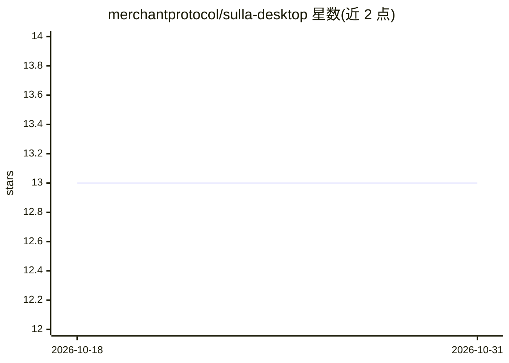

# merchantprotocol/sulla-desktop

⭐ 13 · TypeScript · NOASSERTION · 推送 2026-10-30 · [GitHub](https://github.com/merchantprotocol/sulla-desktop) · [官网](https://sulladesktop.com) · 组织维护

**运行在本机的 AI 执行助理桌面应用，按自然语言构建并定时运行自动化**

基于 Electron（fork 自 Rancher Desktop，内含 Lima VM）的桌面 AI 助理：用户用自然语言描述任务，它生成可视化工作流（触发器、步骤、审批点），按日程/日历/聊天消息运行自动化，如发票催收、邮件分诊、报告抓取等。机制上代理运行在隔离 VM 中，凭据 AES-256 加密存储，每步状态检查点到 Postgres 可断点续跑；内置 Chromium 浏览器与 300+ 集成，模型需用户自接 Anthropic/OpenAI/Grok 等账号或 API key，GPL-2.0+ 开源。

## 筛选速览

| 维度 | 判定 | 备注 |
|---|---|---|
| AI 角色 | `ai-native` | 本体是模型或模型工具 |
| 许可风险 | `none` | NOASSERTION |
| 部署形态 | `self-host` | docker 或自建部署 |
| 模型依赖 | — | README 未给出锁定关系 |
| 硬件要求 | — | 无带数字的原话,不猜 |
| 安装摩擦 | `low` | 无编译、无系统依赖或容器化 |
| 成熟度 | — | 结构信号不足 |

## 能力要点

- 自然语言生成可编辑的可视化工作流（YAML 文件，可版本控制）
- 代理运行于隔离 VM，凭据 AES-256 加密，支持审批步骤
- 每节点检查点到 Postgres，运行可从断点恢复
- 内置 Chromium 浏览器与 300+ 集成，可驱动无 API 网站

## 适用场景

- 用自然语言设置定期催收发票、跟进线索等重复性业务自动化
- 让 AI 助理处理收件箱分诊、晨报汇总等日常事务
- 登录无导出功能的网站抓取数据并更新表格
- 通过审批步骤保留对对外发送内容的最终决定权

## 场景标签

`工作流自动化` `浏览器自动化` · 领域:效率与自动化

## 证据(README 行号)

> L3:  Sulla is an AI executive assistant that lives on your computer.
> L53: 1. **Describe the job.** Type or say it: *"Every Monday, chase anything unpaid for more than 14 days. Be polite. An
> L54: 2. **Sulla builds the workflow.** It turns your words into a visual workflow: a trigger, the steps, and the checkpo

## 星数曲线

2026-10-18 13 → 2026-10-31 13（+0）

---
*卡片 v1 · prompt 1.4 · 生成 2026-10-31 · 置信度 mid · 依据 README sha `9dbd8bfca708` · [字段定义](../../DATASET.md)*
