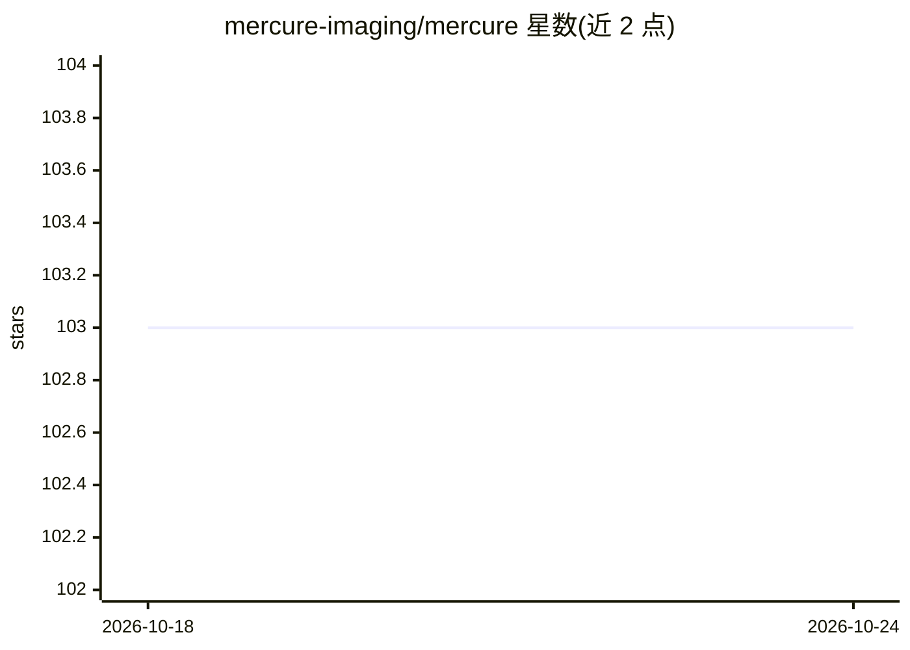

# mercure-imaging/mercure

⭐ 103 · JavaScript · MIT · 推送 2026-10-07 · [GitHub](https://github.com/mercure-imaging/mercure) · [官网](https://mercure-imaging.org) · 组织维护

**医学影像科用的 DICOM 路由与处理编排系统**

用 Python 编写、基于 DCMTK 工具包的 DICOM 路由与处理解决方案，面向医学影像传输与自动化处理场景。由接收、路由、处理、分发、清理、Web 界面、记账等服务模块组成处理流水线；自定义处理模块以 Docker 容器形式实现，可单机 Docker Compose 部署或用 Nomad 做集群扩展。路由模块按规则将序列送入处理或分发路径，处理结果发送到目标 DICOM 节点，全程可通过 Web 界面配置与监控。已被多个研究组采用并集成于 BIDS-flux 多中心神经影像平台。

## 筛选速览

| 维度 | 判定 | 备注 |
|---|---|---|
| AI 角色 | `ai-ecosystem` | LLM/agent 周边工具 |
| 许可风险 | `permissive` | MIT |
| 部署形态 | `self-host` | docker 或自建部署 |
| 模型依赖 | — | README 未给出锁定关系 |
| 硬件要求 | — | 无带数字的原话,不猜 |
| 安装摩擦 | `low` | 无编译、无系统依赖或容器化 |
| 成熟度 | — | 结构信号不足 |

## 能力要点

- 接收/路由/处理/分发/清理等模块化处理流水线
- 自定义处理模块以 Docker 容器实现，支持 Nomad 集群扩展
- Web 界面配置、控制与监控，Postgres 存储监控信息
- 基于 DCMTK 的 DICOM 通信与基于规则的路由

## 适用场景

- 医院或研究机构自动化路由分发 DICOM 影像
- 将深度学习推理模块（Docker 容器）接入影像处理流水线
- 多中心神经影像平台中集中编排影像传输与处理

## 场景标签

`图像视频处理` · 领域:感知与多模态

## 证据(README 行号)

> L7: A flexible DICOM routing and processing solution with user-friendly web interface and extensive monitoring functions
> L29: ## Processor
> L30: The processor module runs periodically and checks for tasks submitted to the `processing` folder. It then locks the

## 星数曲线

2026-10-18 103 → 2026-10-24 103（+0）

---
*卡片 v1 · prompt 1.4 · 生成 2026-10-23 · 置信度 mid · 依据 README sha `edc93d20d7e6` · [字段定义](../../DATASET.md)*
