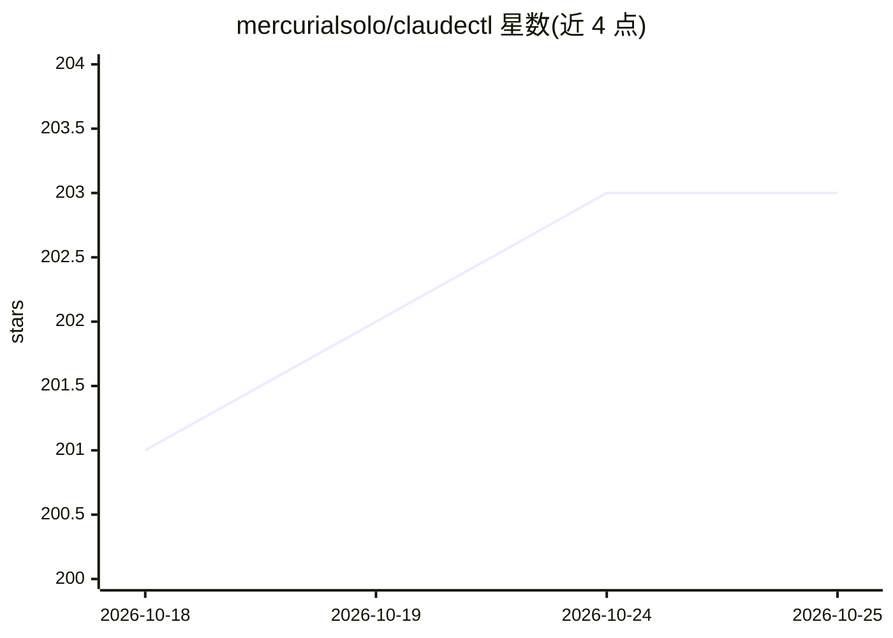

# mercurialsolo/claudectl

⭐ 203 · Rust · MIT · 推送 2026-10-23 · [GitHub](https://github.com/mercurialsolo/claudectl) · [官网](https://mercurialsolo.github.io/claudectl/) · 个人维护

**Claude Code 的本地 LLM 决策大脑与多机蜂群协调 CLI**

Rust 编写的 CLI/TUI 工具，面向 Claude Code 用户：在本地运行 LLM「brain」，观察会话并自动批准/拒绝工具调用、终止异常会话、在会话间路由摘要上下文，并从用户纠正中学习偏好规则；支持 ollama、llama.cpp、vLLM、LM Studio 等任意 OpenAI 兼容端点。另提供跨机器的 Hive/relay 知识同步与按作用域签发只读访问令牌。通过 Homebrew、cargo 等方式安装，约 6 MB 二进制，全部数据留在本机。

## 筛选速览

| 维度 | 判定 | 备注 |
|---|---|---|
| AI 角色 | `ai-ecosystem` | LLM/agent 周边工具 |
| 许可风险 | `permissive` | MIT |
| 部署形态 | `library` | 以包/库形式分发 |
| 模型依赖 | local-ok | 支持本地模型 |
| 硬件要求 | — | 无带数字的原话,不猜 |
| 安装摩擦 | `low` | 无编译、无系统依赖或容器化 |
| 成熟度 | — | 结构信号不足 |

## 能力要点

- 本地 LLM brain 自动批准/拒绝工具调用并从纠正中学习
- 兼容任意 OpenAI 兼容端点（ollama/llama.cpp/vLLM/LM Studio）
- Hive 蜂群：LAN 发现、邀请审批、知识跨机增量同步
- 每个决策附带来源/置信度/依据示例，可导出审计

## 适用场景

- 让本地 LLM 代替人工审批 Claude Code 的工具调用
- 多台机器间同步 agent 学到的最佳实践与工作流
- 向外部人员签发只读、限速的项目问答令牌

## 场景标签

`Agent 框架` `多智能体` · 领域:Agent 开发

## 证据(README 行号)

> L3:  Hive mind for Claude Code - expand your consciousness with an agentic hive that learns from you once and remembers 
> L67: - **Local LLM auto-pilot** — a brain that learns your preferences and auto-approves/denies tool calls. No cloud API
> L92: Works with any OpenAI-compatible endpoint: ollama, llama.cpp, vLLM, LM Studio.

## 星数曲线

2026-10-18 201 → 2026-10-25 203（+2）

---
*卡片 v1 · prompt 1.4 · 生成 2026-10-22 · 置信度 high · 依据 README sha `988da1623149` · [字段定义](../../DATASET.md)*
