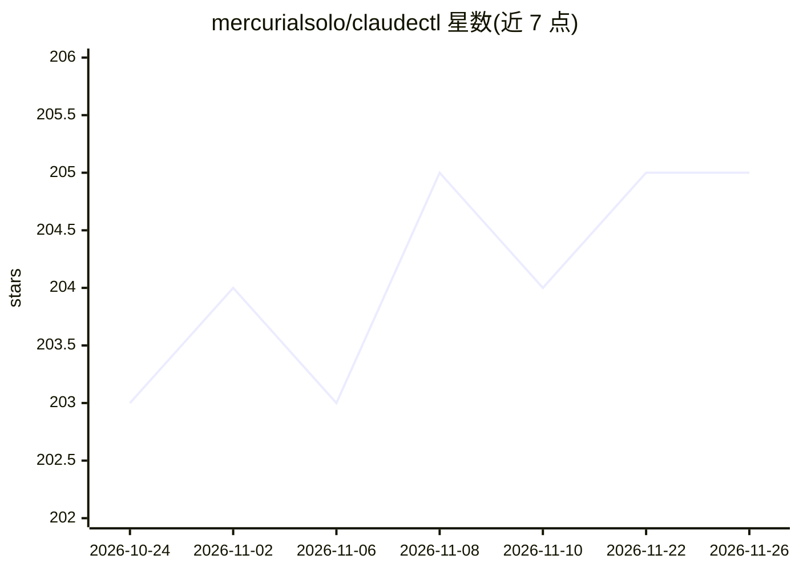

# mercurialsolo/claudectl

⭐ 205 · Rust · MIT · 推送 2026-11-02 · [GitHub](https://github.com/mercurialsolo/claudectl) · [官网](https://mercurialsolo.github.io/claudectl/) · 个人维护

**为 Claude Code 提供多机会话编排与本地 LLM 决策的 CLI 工具**

Rust 编写的 CLI/TUI 工具，围绕 Claude Code 编码会话提供：多会话编排（依赖排序、跨会话上下文路由）、本地 LLM「大脑」自动批准/拒绝工具调用、健康监控（成本激增、错误循环、上下文饱和）以及 Hive 知识共享——多台机器通过 LAN 发现、邀请审批、只读成员等机制增量同步决策知识。安装后约 6 MB 二进制，无需云 API；分类路由为可选项且默认关闭。提供 Claude Code 插件内联使用。

## 筛选速览

| 维度 | 判定 | 备注 |
|---|---|---|
| AI 角色 | `ai-ecosystem` | LLM/agent 周边工具 |
| 许可风险 | `permissive` | MIT |
| 部署形态 | `library` | 以包/库形式分发 |
| 模型依赖 | local-ok | 支持本地模型 |
| 硬件要求 | — | 无带数字的原话,不猜 |
| 安装摩擦 | `low` | 无编译、无系统依赖或容器化 |
| 成熟度 | — | 结构信号不足 |

## 能力要点

- 本地 LLM 大脑自动批准/拒绝工具调用，决策记录可导出审计
- Hive 知识同步：LAN 发现、邀请审批、只读成员与增量传播
- 多会话编排与健康监控（成本、错误循环、上下文饱和）
- 兼容任何 OpenAI-compatible 端点（ollama/llama.cpp/vLLM/LM Studio）

## 适用场景

- 在多台 Mac 之间同步编码 agent 学到的经验与规则
- 让本地 LLM 自动审批低风险工具调用并终止失控会话
- 向外部协作者发放只读能力令牌，让其查询项目并获得带引用的回答

## 场景标签

`编码 Agent` · 领域:编码与开发

## 证据(README 行号)

> L3:  Hive mind for Claude Code - expand your consciousness with an agentic hive that learns from you once and remembers 
> L76: - **Local LLM auto-pilot** — a brain that learns your preferences and auto-approves/denies tool calls. No cloud API
> L78: - **Multi-session orchestration** — run parallel tasks with dependency ordering and cross-session context routing.

## 星数曲线

2026-10-24 203 → 2026-11-26 205（+2）

---
*卡片 v1 · prompt 1.4 · 生成 2026-11-25 · 置信度 high · 依据 README sha `52e9fac30a48` · [字段定义](../../DATASET.md)*
