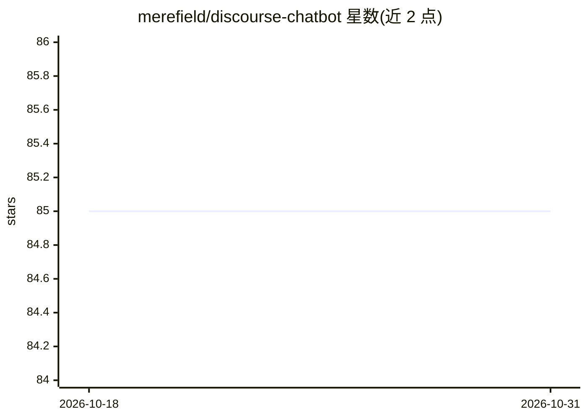

# merefield/discourse-chatbot

⭐ 85 · Ruby · GPL-2.0 · 推送 2026-10-26 · [GitHub](https://github.com/merefield/discourse-chatbot) · 个人维护

**给 Discourse 论坛的 RAG AI 聊天机器人插件，支持社区内容客服**

Discourse 论坛的 AI 聊天机器人插件：在帖子、私信、Chat 频道与线程中通过 @提及等方式对话，可基于社区内容回答客服问题。机制上为论坛帖子与主题标题生成 embeddings（存储于 pgvector）实现本地语义搜索，嵌入范围由 benchmark_user 或 categories 策略决定，私信永不嵌入；语义搜索不做逐请求权限检查，需通过嵌入范围配置控制泄露风险。支持 OpenAI、Anthropic、Google Gemini、xAI 及 Azure、OpenAI 兼容代理连接，提供按信任级别的工具白名单与配额系统，以及视觉、图像生成、PDF 输入等工具。

## 筛选速览

| 维度 | 判定 | 备注 |
|---|---|---|
| AI 角色 | `ai-native` | 本体是模型或模型工具 |
| 许可风险 | `viral` | GPL-2.0 |
| 部署形态 | `None` |  |
| 模型依赖 | — | README 未给出锁定关系 |
| 硬件要求 | — | 无带数字的原话,不猜 |
| 安装摩擦 | `low` | 无编译、无系统依赖或容器化 |
| 成熟度 | — | 结构信号不足 |

## 能力要点

- Discourse 插件形式：机器人可在帖子、私信、Chat 频道与线程中对话
- 论坛帖子 embeddings 本地语义搜索（RAG），范围按 benchmark_user 或 categories 策略控制，私信不嵌入
- 支持 OpenAI、Anthropic、Google Gemini、xAI 及 Azure、OpenAI 兼容代理连接
- 按信任级别的工具白名单与配额系统；提供视觉、图像生成、PDF 输入等工具

## 适用场景

- 在社区论坛中提供基于社区内容的客服问答机器人
- 让成员通过 @提及、私信或 Chat 与机器人对话
- 按信任级别和付费会员控制对机器人的访问与配额

## 场景标签

`聊天机器人` `RAG` · 领域:对话与助手

## 证据(README 行号)

> L15: * The original Discourse AI Chatbot!
> L16: * Can provide customer-support answers grounded in your community content; see Building a technical support chatbot
> L33: * Uses the tool-calling capabilities of OpenAI, Anthropic, Google Gemini, and xAI models through their OpenAI-compa

## 星数曲线

2026-10-18 85 → 2026-10-31 85（+0）

---
*卡片 v1 · prompt 1.4 · 生成 2026-10-24 · 置信度 high · 依据 README sha `f97d805c7724` · [字段定义](../../DATASET.md)*
