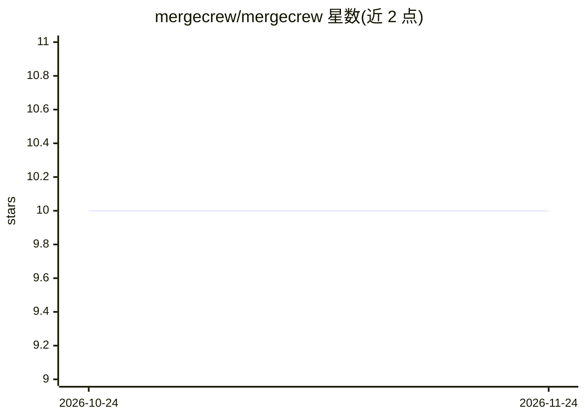

# mergecrew/mergecrew

⭐ 10 · TypeScript · Apache-2.0 · 推送 2026-08-27 · [GitHub](https://github.com/mergecrew/mergecrew) · 组织维护

**多智能体软件开发生命周期平台，按日产出 PR 并有人工生产闸门**

以多智能体团队形式运行完整 SDLC 循环：由 cron 定时触发 Planner/Coder/Reviewer 等角色，完成规格、编码、部署到 dev 环境、bug 扫描并生成待人工审批的 digest，任何变更进入生产前必须人工决定 Promote/Defer/Rollback。架构为 pnpm monorepo：四个 NestJS 服务加 Next.js 前端，Postgres（RLS 多租户）+ Redis/BullMQ + S3 兼容存储，Agent 以 LangGraph 状态图运行，LLM 提供方可插拔。当前为 alpha 状态，API 与数据库 schema 不保证稳定。

## 筛选速览

| 维度 | 判定 | 备注 |
|---|---|---|
| AI 角色 | `ai-native` | 本体是模型或模型工具 |
| 许可风险 | `permissive` | Apache-2.0 |
| 部署形态 | `self-host` | docker 或自建部署 |
| 模型依赖 | local-ok | 支持本地模型 |
| 硬件要求 | — | 无带数字的原话,不猜 |
| 安装摩擦 | `low` | 无编译、无系统依赖或容器化 |
| 成熟度 | `idea` | |

## 能力要点

- 定时 cron 驱动的完整生命周期：spec→设计→构建→部署 dev→bug 扫描→digest→人工审批
- 多租户设计：每 org 独立 RLS 隔离、预算、provider key 与 runner 配置（BYO）
- LLM 提供方可插拔：Anthropic、OpenAI、AWS Bedrock、本地 Ollama
- Demo 模式以确定性 stub 运行全部多智能体流程，无需配置 LLM key

## 适用场景

- 让 agent 团队每天对我的真实仓库自动产出变更并在 digest 中统一审批
- 自托管一套多租户的 agent 开发平台并按 org 配置预算与 LLM key
- 在生产部署前强制保留人工闸门的自动化编码流程

## 场景标签

`多智能体` `编码 Agent` · 领域:Agent 开发

## 证据(README 行号)

> L13: Mergecrew is the open-source platform for running an **agentic software development lifecycle** — multi-agent produ
> L94: - **Agent runtime.** LangGraph.js graph + LangChain.js provider integrations (Anthropic, OpenAI, AWS Bedrock, Ollam

## 星数曲线

2026-10-24 10 → 2026-11-24 10（+0）

---
*卡片 v1 · prompt 1.4 · 生成 2026-11-19 · 置信度 mid · 依据 README sha `cc88570bb978` · [字段定义](../../DATASET.md)*
