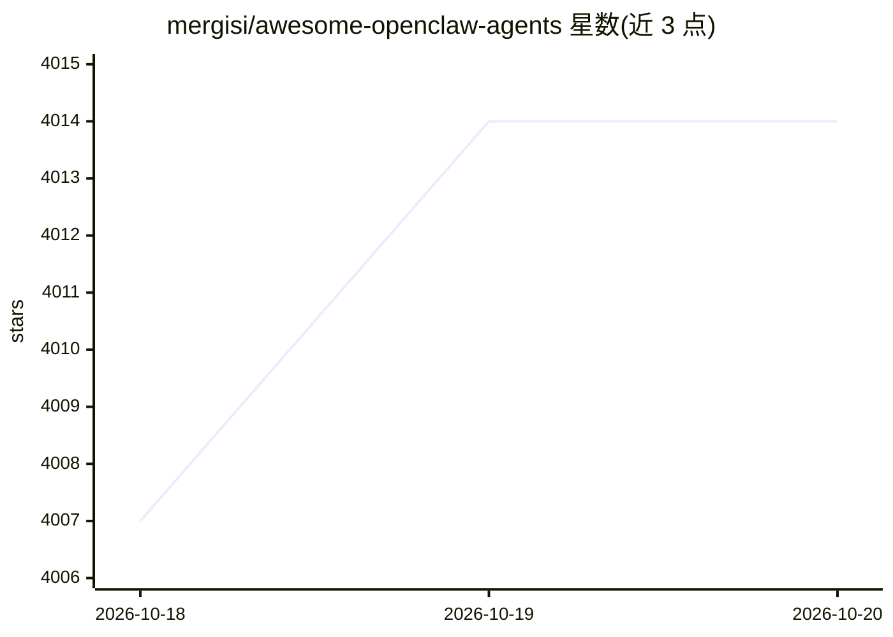

# mergisi/awesome-openclaw-agents

⭐ 4,014 · HTML · MIT · 推送 2026-09-26 · [GitHub](https://github.com/mergisi/awesome-openclaw-agents) · [官网](https://crewclaw.com) · 个人维护

**OpenClaw 生态的 AI agent 模板策展清单（205 个 SOUL.md，多类别）**

面向 OpenClaw agent 框架的模板聚合仓库：收录 205 个可直接复制使用的 SOUL.md 配置模板，按生产力、开发、营销内容、商务、个人、DevOps 等类别组织，每个条目标注专长与适用场景。使用方式为复制 SOUL.md、通过 openclaw agents add 注册并启动网关；仓库含 agents.json 机器可读版本与 quickstart 工程（git clone + npm install + node bot.js）。部分模板标注需 OpenClaw v2026.4.5+，仓库同时导流至付费部署包生成服务 CrewClaw 与 Newsletter。

## 筛选速览

| 维度 | 判定 | 备注 |
|---|---|---|
| AI 角色 | `ai-knowledge` | 知识聚合/清单类 |
| 许可风险 | `permissive` | MIT |
| 部署形态 | `self-host` | docker 或自建部署 |
| 模型依赖 | — | README 未给出锁定关系 |
| 硬件要求 | — | 无带数字的原话,不猜 |
| 安装摩擦 | `low` | 无编译、无系统依赖或容器化 |
| 成熟度 | — | 结构信号不足 |

## 能力要点

- 205 个 SOUL.md 格式的 agent 模板，复制即用
- agents.json 提供全量机器可读版本
- quickstart 工程含 git clone + npm + node 启动流程
- 模板覆盖开发、营销、商务、个人、DevOps 等多类别

## 适用场景

- 为 OpenClaw agent 网关挑选现成的角色模板
- 浏览不同类别 agent 的能力与适用场景
- 通过 agents.json 程序化获取模板清单

## 场景标签

`精选清单` `提示工程` · 领域:Agent 开发

## 证据(README 行号)

> L10: > A curated collection of **205 production-ready AI agent templates** for the OpenClaw ecosystem. Every template is
> L30: Ready-to-use SOUL.md templates for your AI agents. Copy the SOUL.md, register with `openclaw agents add`, and start

## 星数曲线

2026-10-18 4,007 → 2026-10-20 4,014（+7）

---
*卡片 v1 · prompt 1.4 · 生成 2026-10-20 · 置信度 mid · 依据 README sha `c16168dd8bdb` · [字段定义](../../DATASET.md)*
