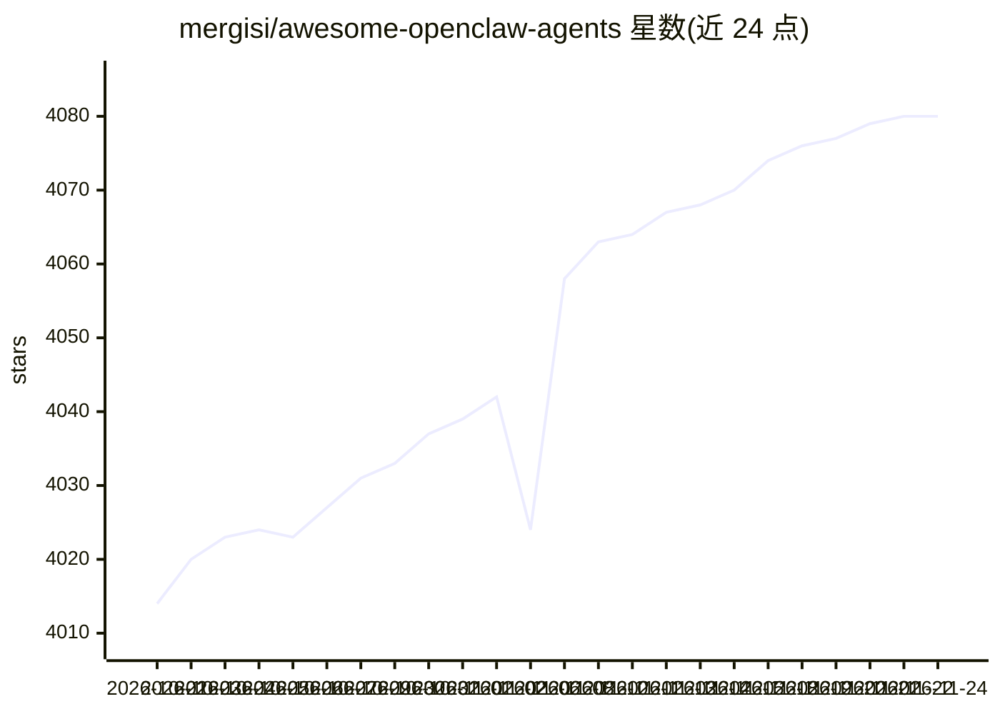

# mergisi/awesome-openclaw-agents

⭐ 4,080 · HTML · MIT · 推送 2026-11-04 · [GitHub](https://github.com/mergisi/awesome-openclaw-agents) · [官网](https://crewclaw.com) · 个人维护

**面向 OpenClaw 生态的 197 个 SOUL.md agent 模板清单**

为 OpenClaw 生态整理的 agent 模板精选清单，共 197 个可直接复制的 SOUL.md 配置文件，按生产力、开发、营销内容、商业、个人、DevOps 等 24 个类别组织。每个模板标注专长与适用场景，复制后通过 `openclaw agents add` 注册并启动 gateway 即可运行；所有 agent 与模型配置另以 agents.json 机器可读格式提供。仓库附带快速开始脚本（git clone + npm install + node bot.js），并引导用户使用 CrewClaw 生成含 Dockerfile 的部署包；部分多媒体模板要求 OpenClaw v2026.4.5+。

## 筛选速览

| 维度 | 判定 | 备注 |
|---|---|---|
| AI 角色 | `ai-knowledge` | 知识聚合/清单类 |
| 许可风险 | `permissive` | MIT |
| 部署形态 | `self-host` | docker 或自建部署 |
| 模型依赖 | — | README 未给出锁定关系 |
| 硬件要求 | — | 无带数字的原话,不猜 |
| 安装摩擦 | `low` | 无编译、无系统依赖或容器化 |
| 成熟度 | — | 结构信号不足 |

## 能力要点

- 197 个 SOUL.md 模板，24 个类别组织，标注专长与适用场景
- 复制 SOUL.md 后经 openclaw agents add 注册即可运行
- 所有 agent 与模型配置提供 agents.json 机器可读格式
- quickstart 脚本支持 git clone 后 npm install 直接启动

## 适用场景

- 为 OpenClaw agent 按岗位挑选现成的 SOUL.md 模板
- 给团队找 PR 审查、客服分诊、DevOps 监控等场景的 agent 配置
- 把博客内容再加工为短视频/社交帖子的营销自动化配置

## 场景标签

`精选清单` `多智能体` · 领域:Agent 开发

## 证据(README 行号)

> L10: > A curated collection of **197 production-ready AI agent templates** for the OpenClaw ecosystem. Every template is
> L30: Ready-to-use SOUL.md templates for your AI agents. Copy the SOUL.md, register with `openclaw agents add`, and start
> L42: > **Skip the setup?** CrewClaw generates a full deploy package (Dockerfile + docker-compose + bot + README) for any

## 星数曲线

2026-10-21 4,014 → 2026-11-24 4,080（+66）

---
*卡片 v1 · prompt 1.4 · 生成 2026-11-23 · 置信度 mid · 依据 README sha `de82c2bd8d7e` · [字段定义](../../DATASET.md)*
