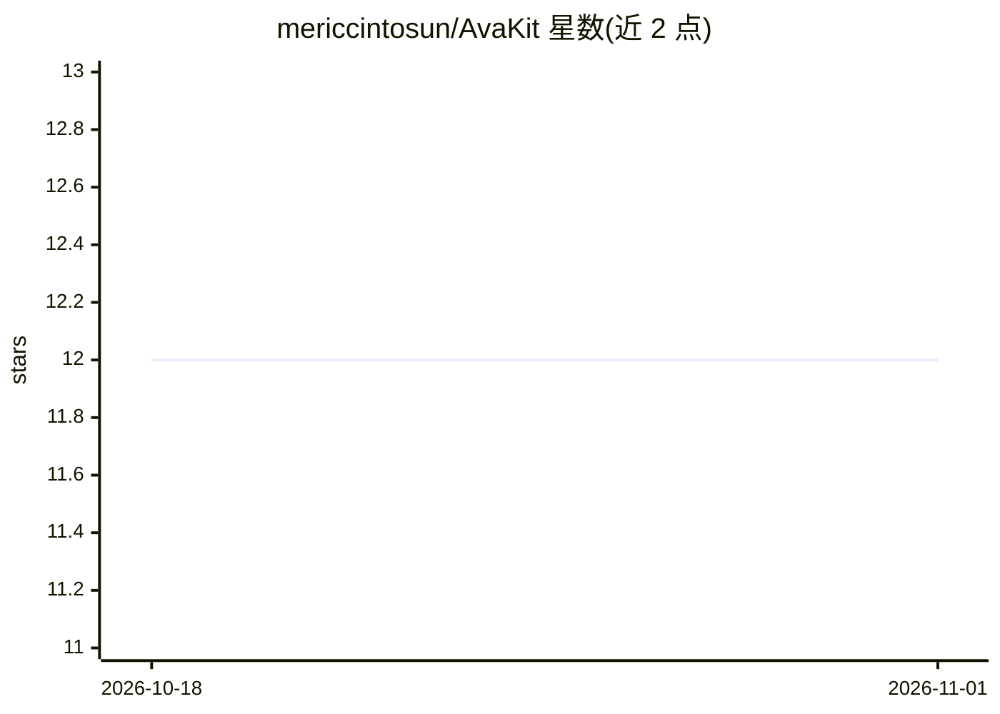

# mericcintosun/AvaKit

⭐ 12 · TypeScript · MIT · 推送 2026-10-22 · [GitHub](https://github.com/mericcintosun/AvaKit) · [官网](https://avakit.dev/) · 个人维护

**面向 Avalanche 的 AI 原型 dapp 脚手架与开发工具箱**

以 create-avalanche-app 为核心的 monorepo 工具箱：一条 npm 命令生成带社交登录钱包、shadcn/ui 主题与链上部署能力的 Avalanche dapp，提供 8 个模板（NFT 铸造、ERC-20、L1 启动、跨链桥等）。包结构包括框架无关内核 @avakit/core、React 组件库、本地开发面板 @avakit/studio 与 @avakit/mcp MCP 服务器，后者让 Claude Code / Cursor 代为脚手架、部署合约并读取链状态。基于 viem、Web3Auth、Foundry 构建，默认 Fuji 测试网，Node ≥ 20.11，ESM-only。

## 筛选速览

| 维度 | 判定 | 备注 |
|---|---|---|
| AI 角色 | `ai-ecosystem` | LLM/agent 周边工具 |
| 许可风险 | `permissive` | MIT |
| 部署形态 | `library` | 以包/库形式分发 |
| 模型依赖 | — | README 未给出锁定关系 |
| 硬件要求 | — | 无带数字的原话,不猜 |
| 安装摩擦 | `low` | 无编译、无系统依赖或容器化 |
| 成熟度 | — | 结构信号不足 |

## 能力要点

- 8 个 dapp 模板，一条命令脚手架并可在浏览器直接部署合约
- @avakit/mcp MCP 服务器供 Claude Code / Cursor 脚手架、部署、读链状态
- 生成应用附带 CLAUDE.md / llms.txt / .cursor/rules 等 AI 上下文文件
- 零配置社交登录（Google）与临时浏览器钱包，无助记词

## 适用场景

- 一条命令生成带社交登录的 Avalanche dapp 并部署到 Fuji
- 通过 AI 编码代理（MCP）直接脚手架和部署合约
- 在现有 React 应用中接入 Avalanche 钱包与交易组件

## 场景标签

`代码生成` · 领域:编码与开发

## 证据(README 行号)

> L37: - **AI-native by default**: every generated app ships `CLAUDE.md`, `llms.txt`, and `.cursor/rules`, and `@avakit/mc
> L50: |`@avakit/mcp`|MCP server: scaffold, deploy, and read Avalanche from Claude Code / Cursor|
> L91: Add the MCP server to Claude Code, Cursor, or Claude Desktop:

## 星数曲线

2026-10-18 12 → 2026-11-01 12（+0）

---
*卡片 v1 · prompt 1.4 · 生成 2026-11-01 · 置信度 high · 依据 README sha `7475195a9f73` · [字段定义](../../DATASET.md)*
