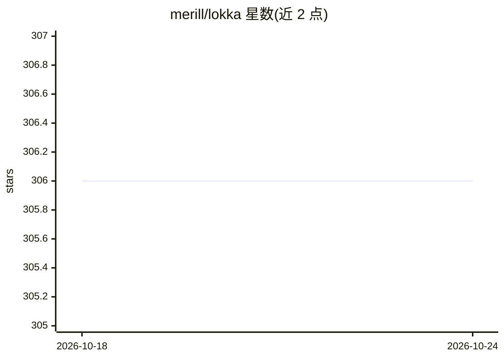

# merill/lokka

⭐ 306 · JavaScript · MIT · 推送 2026-09-25 · [GitHub](https://github.com/merill/lokka) · [官网](https://lokka.dev) · 个人维护

**让 AI 客户端用自然语言管理 Microsoft 365 与 Azure 租户的 MCP 服务器**

Lokka 是一个 Model Context Protocol (MCP) 服务器，封装 Microsoft Graph 与 Azure Resource Manager API，供 Claude Desktop 或任意 MCP 客户端通过自然语言查询和管理 Azure 与 Microsoft 365 租户（如创建安全组、查询条件访问策略、查看 Intune 配置）。提供四种认证方式：交互式登录、自定义 Entra 应用、证书/客户端密钥的 App-Only 模式及客户端提供令牌模式。核心工具 Lokka-Microsoft 可发起任意 Graph/Azure HTTP 调用，支持切换 beta/v1.0 API 版本，通过环境变量完成配置。

## 筛选速览

| 维度 | 判定 | 备注 |
|---|---|---|
| AI 角色 | `ai-ecosystem` | LLM/agent 周边工具 |
| 许可风险 | `permissive` | MIT |
| 部署形态 | `None` |  |
| 模型依赖 | — | README 未给出锁定关系 |
| 硬件要求 | — | 无带数字的原话,不猜 |
| 安装摩擦 | `low` | 无编译、无系统依赖或容器化 |
| 成熟度 | — | 结构信号不足 |

## 能力要点

- 封装 Microsoft Graph 与 Azure RM API 为单一 MCP 工具调用
- 四种认证模式：交互式、自定义 Entra 应用、证书/密钥、客户端令牌
- Graph API 版本控制（beta 默认，可强制 v1.0）
- 令牌管理与认证状态查询工具（set-access-token / get-auth-status）

## 适用场景

- 通过 Claude Desktop 等客户端用自然语言管理 Microsoft 365 租户
- 查询与更新 Azure 资源、条件访问策略、Intune 配置
- 以 App-Only 认证在无人值守场景下接入 Microsoft API

## 场景标签

 · 领域:云管理/AI 客户端集成

## 证据(README 行号)

> L9: Lokka is a model-context-protocol server for the Microsoft Graph and Azure RM APIs that allows you to query and mana
> L15: Lokka lets you use Claude Desktop, or any MCP Client, to use natural language to accomplish things in your Azure an

## 星数曲线

2026-10-18 306 → 2026-10-24 306（+0）

---
*卡片 v1 · prompt 1.4 · 生成 2026-10-21 · 置信度 high · 依据 README sha `345c49f5da81` · [字段定义](../../DATASET.md)*
