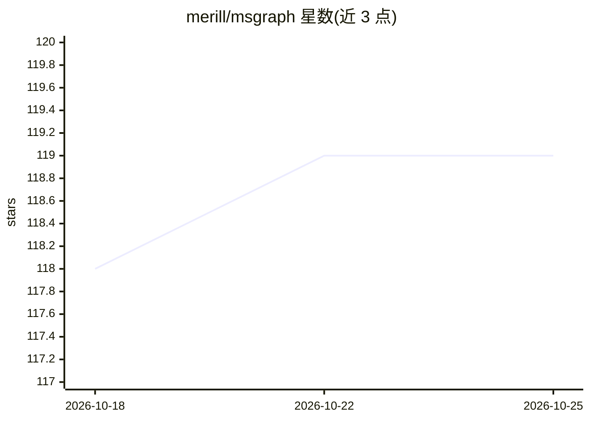

# merill/msgraph

⭐ 119 · Go · MIT · 推送 2026-10-24 · [GitHub](https://github.com/merill/msgraph) · [官网](https://graph.pm) · 个人维护

**给 AI agent 的 Microsoft Graph API 知识技能包，含本地索引与直连调用**

面向 AI agent 的 Agent Skill：将全部 Microsoft Graph API 面（27,700+ 端点、6,200+ 端点文档、4,200+ 资源 schema、社区示例）打包为本地索引，检索零网络调用，用于减少 agent 编造端点、使用弃用路径等问题。支持配合任意 Microsoft Graph MCP server 执行调用，或经 MSAL 认证直接调用 API；GET 默认放行、写操作需确认。跨平台单二进制，Go 源码构建需 Go 1.22+。

## 筛选速览

| 维度 | 判定 | 备注 |
|---|---|---|
| AI 角色 | `ai-knowledge` | 知识聚合/清单类 |
| 许可风险 | `permissive` | MIT |
| 部署形态 | `desktop` | 安装包/桌面程序 |
| 模型依赖 | — | README 未给出锁定关系 |
| 硬件要求 | — | 无带数字的原话,不猜 |
| 安装摩擦 | `low` | 无编译、无系统依赖或容器化 |
| 成熟度 | — | 结构信号不足 |

## 能力要点

- 27,700+ Graph 端点等完整 API 面打包为本地索引，检索无需网络
- 兼容任意 Microsoft Graph MCP server（如 lokka.dev）执行调用
- MSAL 认证（浏览器流+设备码回退、app-only）直接调用 Graph API
- GET 默认允许、写操作需显式确认

## 适用场景

- 让 AI agent 基于最新 Graph API 知识回答与生成调用
- 在无 MCP server 环境下经 MSAL 认证直接执行 Graph API 调用
- 按任务检索映射到具体 API 查询的社区示例

## 场景标签

`Agent 框架` · 领域:Agent 开发

## 证据(README 行号)

> L3: An Agent Skill that gives AI agents up-to-date knowledge of the complete Microsoft Graph API — and optionally execut
> L11: This skill bundles the complete Microsoft Graph API surface as local indexes — searchable instantly with zero netwo

## 星数曲线

2026-10-18 118 → 2026-10-25 119（+1）

---
*卡片 v1 · prompt 1.4 · 生成 2026-10-23 · 置信度 high · 依据 README sha `36e105f60541` · [字段定义](../../DATASET.md)*
