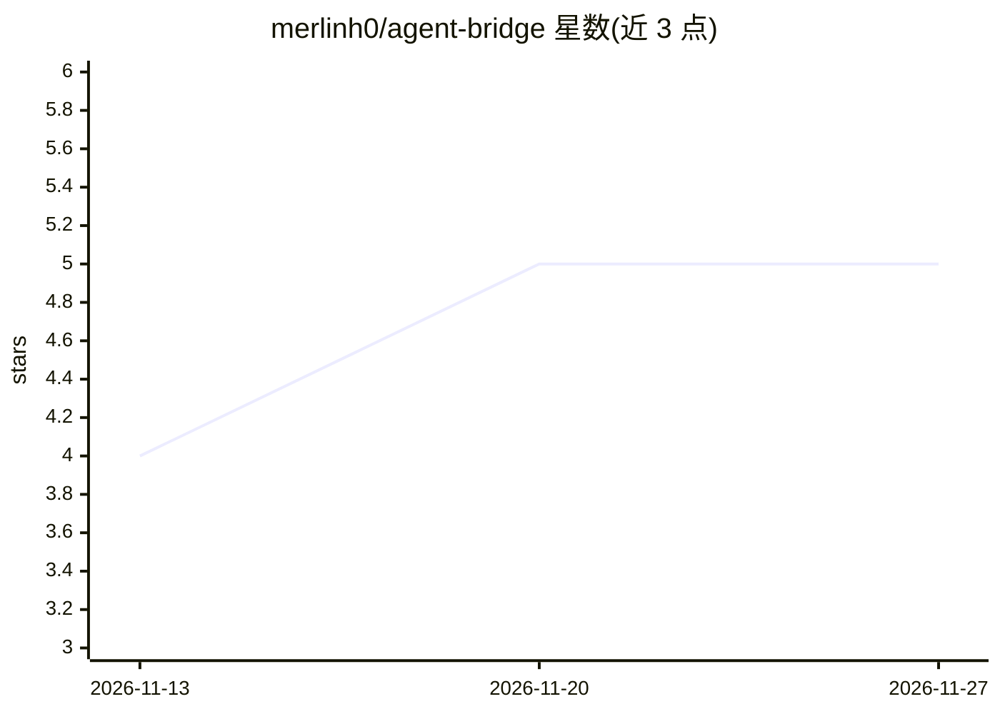

# merlinh0/agent-bridge

⭐ 5 · Python · MIT · 推送 2026-11-17 · [GitHub](https://github.com/merlinh0/agent-bridge) · 个人维护

**MCP server：从 Claude 编排并行 AI 编码 agent**

一个 MCP server，把 Claude Desktop 或 Claude Code 对话变成并行 AI 编码 agent 的编排器。每个 agent 在独立 Tern 终端标签与隔离仓库副本（ovnfs 或 git worktree）及独立分支中运行，可通过 omp 引擎使用本机可用模型，或以 Claude Code 作为第二引擎。编排器负责规划任务、启动 agent、跟踪进度、读取报告与 diff 并发送修正。要求 macOS、Tern、omp、git；通过安装脚本或 uv tool 安装。

## 筛选速览

| 维度 | 判定 | 备注 |
|---|---|---|
| AI 角色 | `ai-ecosystem` | LLM/agent 周边工具 |
| 许可风险 | `permissive` | MIT |
| 部署形态 | `None` |  |
| 模型依赖 | locked-api |  |
| 硬件要求 | — | 无带数字的原话,不猜 |
| 安装摩擦 | `low` | 无编译、无系统依赖或容器化 |
| 成熟度 | — | 结构信号不足 |

## 能力要点

- 每个 agent 运行在隔离仓库副本与 agent/<name> 分支，避免相互冲突
- 通过 omp 引擎使用本机可用模型，模型层级由实时目录按价格动态计算
- 支持 set_model_policy 设置模型白名单与层级规则并在启动时强制执行
- 提供 wait_for_agents 监控、get_diff 变更读取与可选 Tern Agents 面板插件

## 适用场景

- 在 Claude 对话中并行启动多个编码 agent 处理独立子任务
- 让多个 agent 各自在独立分支工作后合并接受的分支
- 通过模型策略限制 agent 只能使用指定模型

## 场景标签

`多智能体` `编码 Agent` · 领域:Agent 开发

## 证据(README 行号)

> L3: **agent-bridge** is an MCP server that turns a Claude conversation (Claude Desktop or Claude Code) into an **orchest
> L24: - **Any model, any provider.** The default omp engine can use every model omp exposes on your machine: Anthropic, O

## 星数曲线

2026-11-13 4 → 2026-11-27 5（+1）

---
*卡片 v1 · prompt 1.4 · 生成 2026-11-21 · 置信度 high · 依据 README sha `89436a893b3c` · [字段定义](../../DATASET.md)*
