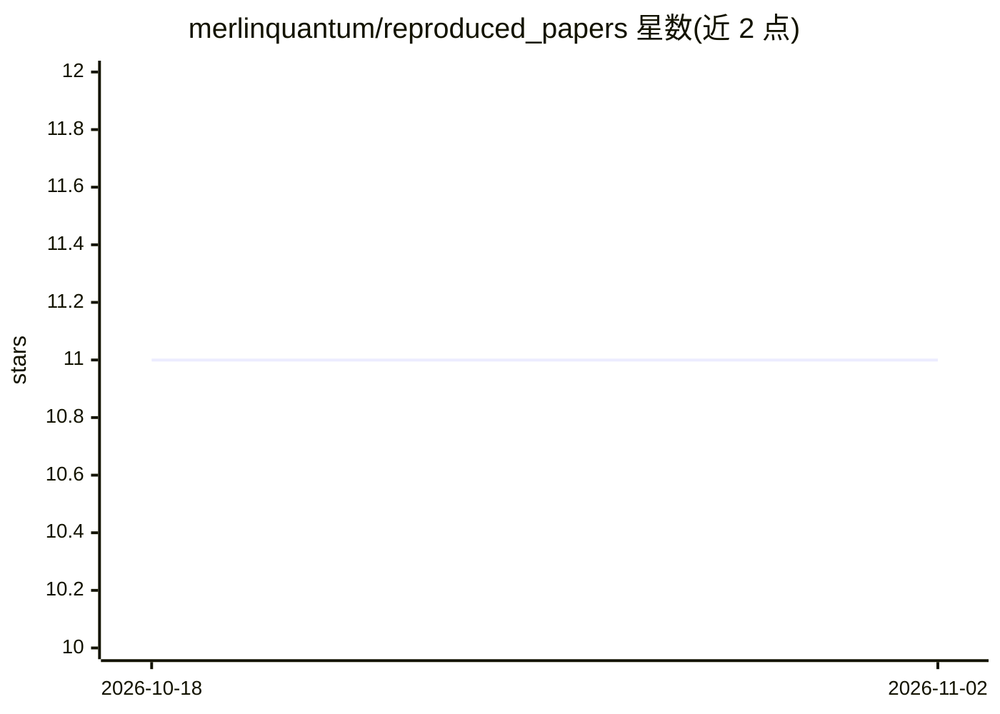

# merlinquantum/reproduced_papers

⭐ 11 · Jupyter Notebook · MIT · 推送 2026-09-21 · [GitHub](https://github.com/merlinquantum/reproduced_papers) · [官网](https://merlinquantum.ai/reproduced_papers) · 组织维护

**量子机器学习论文的光子计算复现代码与基准结果集合**

MerLin 项目的研究子仓库，收录 30 余篇量子机器学习论文的复现实现，聚焦光子/光学量子计算。每条复现给出所用方法（光子储备池计算、QCNN、量子核、QGAN、量子强化学习等）与结果，多数条目同时与经典基线及门模型量子方法对比数据（如 PennyLane、Qiskit、TorchQuantum 分支）。以论文表格形式组织，部分复现标注了限制（如未含原始 CFD 目标场、结果为初步）。面向量子机器学习研究者与复现验证需求。

## 筛选速览

| 维度 | 判定 | 备注 |
|---|---|---|
| AI 角色 | `ai-native` | 本体是模型或模型工具 |
| 许可风险 | `permissive` | MIT |
| 部署形态 | `library` | 以包/库形式分发 |
| 模型依赖 | — | README 未给出锁定关系 |
| 硬件要求 | — | 无带数字的原话,不猜 |
| 安装摩擦 | `medium` | 含编译或系统依赖之一 |
| 成熟度 | `idea` | |

## 能力要点

- 30+ 篇 QML 论文的复现实现，聚焦光子量子计算
- 多数复现包含经典基线与门模型方法的对比数据
- 覆盖储备池计算、QCNN、量子核、QGAN、量子强化学习等方向
- 部分条目明示复现限制与结果偏差

## 适用场景

- 验证已发表 QML 论文结果的可复现性
- 对比光子 QML 与经典/门模型方法的性能
- 基于已有复现扩展自己的量子机器学习实验

## 场景标签

`模型评测` · 领域:评测与运维

## 证据(README 行号)

> L5: This repository contains implementations and resources for reproducing key quantum machine learning papers, with a f
> L19: |Quantum Optical Reservoir Computing. Source: sakurai_2025|We implement the boson-sampling reservoir, MNIST digit c
> L21: |Computational Advantage in Hybrid Quantum NeuralNetworks: Myth or Reality?. Source: kashif_2024|The original paper

## 星数曲线

2026-10-18 11 → 2026-11-02 11（+0）

---
*卡片 v1 · prompt 1.4 · 生成 2026-11-02 · 置信度 mid · 依据 README sha `98c3b9a16770` · [字段定义](../../DATASET.md)*
