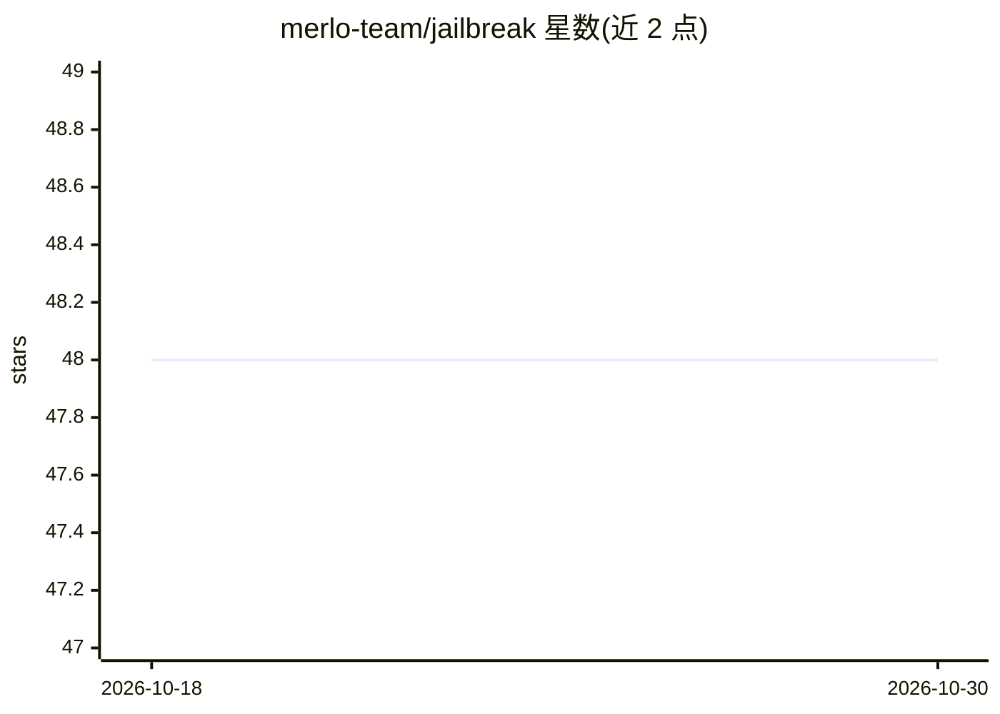

# merlo-team/jailbreak

⭐ 48 · JavaScript · 推送 2026-09-05 · [GitHub](https://github.com/merlo-team/jailbreak) · [官网](https://jailbreakme.xyz) · 组织维护

**去中心化平台：组织发布 AI 模型供用户攻破以获取赏金**

基于 Solana 智能合约的去中心化应用（jailbreakme.xyz）：组织创建 AI agent 挑战并设定奖池、消息定价与到期规则；用户向 LLM 提交提示词尝试越狱，由 AI 模型自身调用 handleChallengeSuccess/Failed 函数判定成败，成功时自动发放奖池。创建 agent 支持提示词描述由 AI 生成配置、快速创建与含函数调用的高级配置，并可提交表单获得自定义 API 集成。定位为生产部署前发现提示词漏洞的众测平台。

## 筛选速览

| 维度 | 判定 | 备注 |
|---|---|---|
| AI 角色 | `ai-ecosystem` | LLM/agent 周边工具 |
| 许可风险 | `none` | — |
| 部署形态 | `None` |  |
| 模型依赖 | — | README 未给出锁定关系 |
| 硬件要求 | — | 无带数字的原话,不猜 |
| 安装摩擦 | `low` | 无编译、无系统依赖或容器化 |
| 成熟度 | — | 结构信号不足 |

## 能力要点

- AI 模型自行评估提交并调用链上函数判定挑战成败
- Solana 智能合约自动发放奖池
- 挑战可配置奖池、消息定价与到期时间
- 支持 Prompt Launch / Quick / Advanced 三种 agent 创建方式及 API 集成

## 适用场景

- 组织在上线前以众测方式发现模型的提示词注入漏洞
- 安全研究者参与越狱挑战获取赏金
- 通过自然语言描述快速生成 agent 配置并发布挑战

## 场景标签

`网络安全` · 领域:学习与行业

## 证据(README 行号)

> L3: jailbreakme.xyz is an **open-source decentralized app (dApp)** where organizations test their **AI models and agents
> L19: - Identify **prompt vulnerabilities** and weaknesses **before production deployment**.

## 星数曲线

2026-10-18 48 → 2026-10-30 48（+0）

---
*卡片 v1 · prompt 1.4 · 生成 2026-10-25 · 置信度 mid · 依据 README sha `950132939bea` · [字段定义](../../DATASET.md)*
