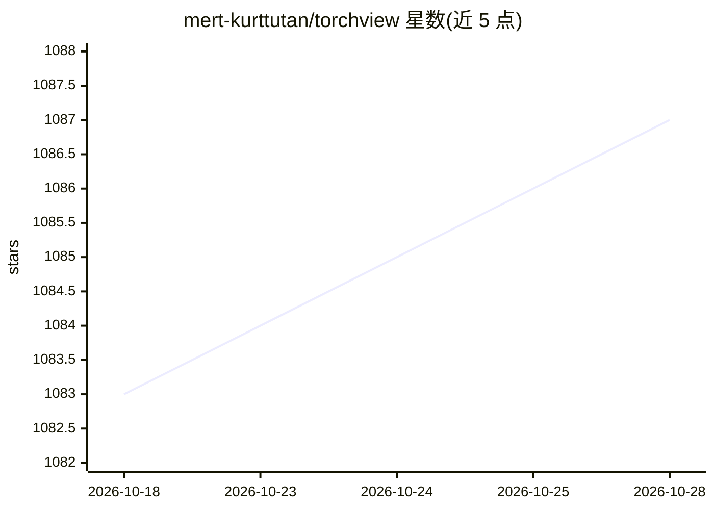

# mert-kurttutan/torchview

⭐ 1,087 · Python · MIT · 推送 2026-02-26 · [GitHub](https://github.com/mert-kurttutan/torchview) · [官网](https://mert-kurttutan.github.io/torchview/) · 个人维护

**将 PyTorch 模型可视化为计算图的 Python 库**

面向 PyTorch 用户的模型结构可视化库：通过 draw_graph 函数将 nn.Module 渲染为 graphviz 图，展示模块、张量、torch.functions 调用及输入/输出形状。支持 RNN、Sequential、跳连、Hugging Face 模型与嵌套输入结构，可展开/折叠递归模块，meta tensors 路径支持超大规模模型且不占内存。依赖系统级 graphviz（dot）方可生成图像。自称相当于 keras plot_model 的 PyTorch 版本，提供 pip/conda/源码三种安装方式，附 Colab 示例笔记本。

## 筛选速览

| 维度 | 判定 | 备注 |
|---|---|---|
| AI 角色 | `ai-ecosystem` | LLM/agent 周边工具 |
| 许可风险 | `permissive` | MIT |
| 部署形态 | `library` | 以包/库形式分发 |
| 模型依赖 | — | README 未给出锁定关系 |
| 硬件要求 | — | 无带数字的原话,不猜 |
| 安装摩擦 | `low` | 无编译、无系统依赖或容器化 |
| 成熟度 | — | 结构信号不足 |

## 能力要点

- draw_graph 渲染模块、张量操作与输入/输出形状为 graphviz 图
- 支持 RNN、跳连结构、嵌套模块展开/折叠与嵌套数据结构输入
- meta tensors 支持（PyTorch ≥1.13）处理超大规模模型且不耗内存
- 提供 pip / conda-forge / 源码安装与 Colab 示例笔记本

## 适用场景

- 在论文或报告中展示模型结构与数据流向
- 调试核对各层输入/输出形状是否符合预期
- 梳理含跳连或递归模块的复杂网络结构

## 场景标签

 · 领域:深度学习/开发工具

## 证据(README 行号)

> L11: Torchview provides visualization of pytorch models in the form of visual graphs. Visualization includes tensors, mo
> L113: * Almost all the models, RNN, Sequentials, Skip Connection, Hugging Face Models

## 星数曲线

2026-10-18 1,083 → 2026-10-28 1,087（+4）

---
*卡片 v1 · prompt 1.4 · 生成 2026-10-21 · 置信度 high · 依据 README sha `84dac49336e5` · [字段定义](../../DATASET.md)*
