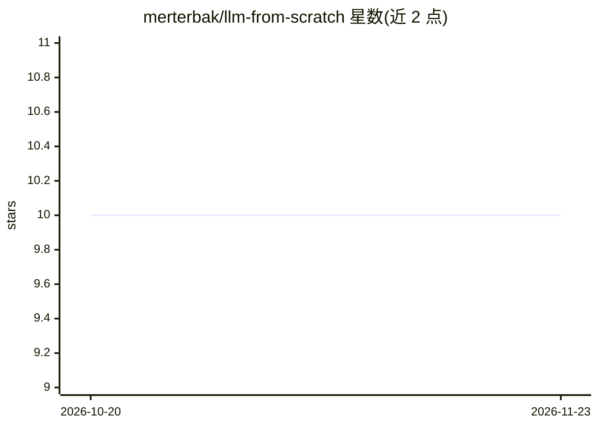

# merterbak/llm-from-scratch

⭐ 10 · Python · Apache-2.0 · 推送 2026-03-12 · [GitHub](https://github.com/merterbak/llm-from-scratch) · 个人维护

**从零实现并训练 0.5B 解码器 LLM 的教学项目**

从零实现并训练一个 0.5B 参数的 decoder-only 稠密 transformer（28 层，10B FineWeb-Edu tokens），架构参考 Qwen3-0.6B。逐一手写 GQA、RoPE（含 YaRN/NTK 外推）、RMSNorm、SwiGLU、WSD 学习率调度与 KV cache 等现代 LLM 组件，项目目标是理解现代 LLM 的构建方式。流程分数据准备、训练、推理生成三步，以 Python 脚本形式提供。

## 筛选速览

| 维度 | 判定 | 备注 |
|---|---|---|
| AI 角色 | `ai-knowledge` | 知识聚合/清单类 |
| 许可风险 | `permissive` | Apache-2.0 |
| 部署形态 | `library` | 以包/库形式分发 |
| 模型依赖 | — | README 未给出锁定关系 |
| 硬件要求 | — | 无带数字的原话,不猜 |
| 安装摩擦 | `low` | 无编译、无系统依赖或容器化 |
| 成熟度 | — | 结构信号不足 |

## 能力要点

- 从零实现 GQA（16 查询头/8 KV 头）、RoPE、SwiGLU、RMSNorm、WSD 调度
- 推理使用 KV cache，每步仅处理新 token
- 实现 YaRN 与 NTK 缩放以扩展有效上下文长度
- 提供 prepare/train/inference 三段式完整训练流程脚本

## 适用场景

- 学习现代 LLM 各组件的从零实现方式
- 在小规模模型上复现预训练流程
- 基于 FineWeb-Edu 训练自己的小型语言模型

## 场景标签

`模型训练` `教程课程` · 领域:学习与行业

## 证据(README 行号)

> L13: The goal of this project was to implement every piece from scratch (GQA, RoPE, SwiGLU, WSD schedule, KV cache) to f
> L56: ## Get started

## 星数曲线

2026-10-20 10 → 2026-11-23 10（+0）

---
*卡片 v1 · prompt 1.4 · 生成 2026-11-19 · 置信度 mid · 依据 README sha `b93ed7be42ca` · [字段定义](../../DATASET.md)*
