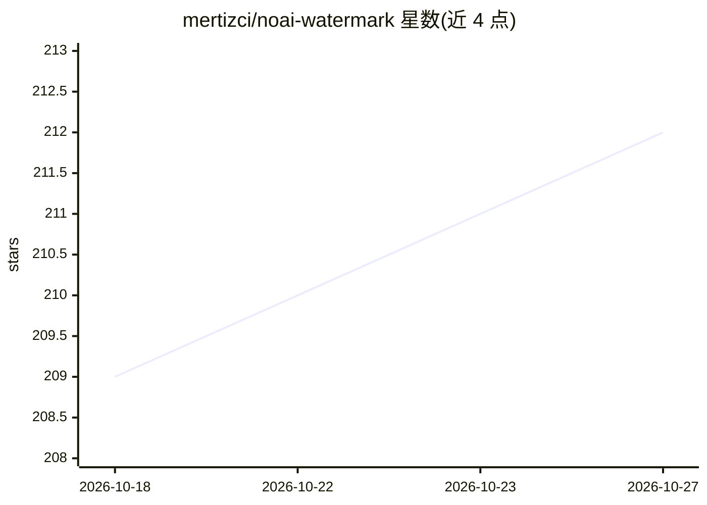

# mertizci/noai-watermark

⭐ 212 · Python · MIT · 推送 2026-09-16 · [GitHub](https://github.com/mertizci/noai-watermark) · [官网](https://github.com/mertizci/noai-watermark) · 个人维护

**移除图像隐形 AI 水印与 AI 元数据的 CLI/Python 工具**

面向需要清理 AI 生成图像痕迹的用户的工具集：通过扩散模型 img2img 或 CtrlRegen（ControlNet + DINOv2 IP-Adapter + 色彩匹配）管线重建像素以干扰 SynthID、StableSignature、TreeRing 等隐形水印，并提供独立的元数据检查、清除与克隆功能（EXIF/XMP/C2PA）。CtrlRegen 采用 512×512 分块处理支持任意分辨率。工具本身不含水印检测器，无法验证水印是否残留；再生成可能改变可见细节。支持 PNG/JPEG/WebP，提供 pip、Homebrew 与源码安装及 Hugging Face Spaces 在线演示。

## 筛选速览

| 维度 | 判定 | 备注 |
|---|---|---|
| AI 角色 | `ai-enhanced` | 去掉 AI 部分产品仍成立 |
| 许可风险 | `permissive` | MIT |
| 部署形态 | `library` | 以包/库形式分发 |
| 模型依赖 | — | README 未给出锁定关系 |
| 硬件要求 | `cpu-ok` | |
| 安装摩擦 | `medium` | 含编译或系统依赖之一 |
| 成熟度 | — | 结构信号不足 |

## 能力要点

- 双管线扩散重建：默认 img2img 与 CtrlRegen（ControlNet + DINOv2 IP-Adapter）
- CtrlRegen 512×512 分块 + 余弦加权融合，支持任意分辨率
- 独立元数据操作：检查/移除 AI 元数据与 C2PA 溯源清单
- 设备自动选择 CUDA/MPS/CPU，无需 GPU

## 适用场景

- 清理 AI 生成图像中的隐形水印以避免被检测
- 检查并移除图像中记录模型与提示词的 AI 元数据
- 在不同图像间克隆元数据或做结构化验证

## 场景标签

`图像视频处理` · 领域:感知与多模态

## 证据(README 行号)

> L14: **noai-watermark** uses diffusion-based image regeneration to disrupt hidden watermark patterns and provides separa
> L286: This targets **invisible/embedded** watermarks (SynthID, StableSignature, TreeRing), not visible logos or text ove

## 星数曲线

2026-10-18 209 → 2026-10-27 212（+3）

---
*卡片 v1 · prompt 1.4 · 生成 2026-10-22 · 置信度 high · 依据 README sha `49b8864235a9` · [字段定义](../../DATASET.md)*
