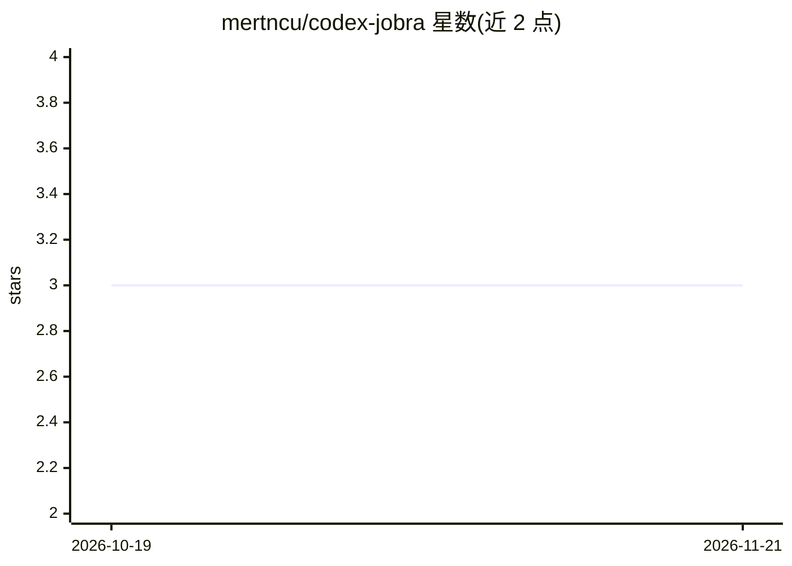

# mertncu/codex-jobra

⭐ 3 · Python · MIT · 推送 2026-10-15 · [GitHub](https://github.com/mertncu/codex-jobra) · 个人维护

**给求职者的 Codex 技能：生成带出处的职位匹配与证据档案**

以 Codex 技能/插件形式运行的求职研究助手：本地解析 PDF/DOCX/Markdown/TXT 简历并草拟带证据链接的候选人档案，用户审核确认后按明确偏好检索真实职位，保留来源 URL、快照与时效信息，再做语义匹配评估与确定性校验，结果存于本地 .jobra/ 目录。依赖 Codex 会话与账号推理，不含独立后端/数据库，扫描版 PDF 不支持，匹配质量未经独立验证，需人工复核。

## 筛选速览

| 维度 | 判定 | 备注 |
|---|---|---|
| AI 角色 | `ai-native` | 本体是模型或模型工具 |
| 许可风险 | `permissive` | MIT |
| 部署形态 | `library` | 以包/库形式分发 |
| 模型依赖 | — | README 未给出锁定关系 |
| 硬件要求 | — | 无带数字的原话,不猜 |
| 安装摩擦 | `low` | 无编译、无系统依赖或容器化 |
| 成熟度 | `idea` | |

## 能力要点

- 简历→证据档案→用户逐项审核→才可进入检索的门控流程
- 职位研究结果保留来源 URL、快照、重复与不确定性记录
- 语义解读用 Codex，约束/聚合/结果文件用 Python 确定性处理
- 读取简历与外发搜索词前要求用户明确批准目的与去向

## 适用场景

- 为审核过的个人档案生成可解释的职位匹配评估
- 按自己的搜索偏好查找并留档带来源的职位机会
- 在本地保存检索快照与结果，自行决定是否投递

## 场景标签

`文档解析` `语义搜索` · 领域:知识与检索

## 证据(README 行号)

> L3: Jobra is a Codex-native skill for people who want
> L24: - Compare a verified profile with validated opportunities using Codex for
> L38: Jobra is a skill-first plugin. Codex handles conversation and semantic

## 星数曲线

2026-10-19 3 → 2026-11-21 3（+0）

---
*卡片 v1 · prompt 1.4 · 生成 2026-11-21 · 置信度 mid · 依据 README sha `fe4289ed67f4` · [字段定义](../../DATASET.md)*
