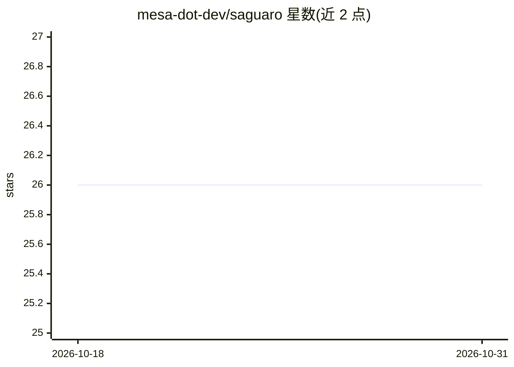

# mesa-dot-dev/saguaro

⭐ 26 · TypeScript · Apache-2.0 · 推送 2026-07-27 · [GitHub](https://github.com/mesa-dot-dev/saguaro) · [官网](https://www.mesa.dev/review-cli) · 组织维护

**面向编码 agent 的本地 AI 代码审查规则引擎**

Saguaro 是本地运行的代码审查工具：以 markdown+YAML frontmatter 形式定义团队规则，通过 glob 匹配变更文件，用 tree-sitter+SWC 构建带 token 预算的 import graph 上下文，交由 AI agent（Anthropic/OpenAI/Google）按规则审查，违规时打印并以 exit 1 阻断。面向使用 Claude Code、Codex、Cursor 等编码 agent 的开发者，提供 hooks、MCP server、slash commands 集成与后台 daemon。代码仅发送到所配置的 AI 提供商，可独立于 Claude Code 在 CLI/CI 使用；import graph 支持 TS/JS/Python/Go/Rust/Java/Kotlin，规则本身语言无关。

## 筛选速览

| 维度 | 判定 | 备注 |
|---|---|---|
| AI 角色 | `ai-ecosystem` | LLM/agent 周边工具 |
| 许可风险 | `permissive` | Apache-2.0 |
| 部署形态 | `library` | 以包/库形式分发 |
| 模型依赖 | locked-api |  |
| 硬件要求 | — | 无带数字的原话,不猜 |
| 安装摩擦 | `low` | 无编译、无系统依赖或容器化 |
| 成熟度 | — | 结构信号不足 |

## 能力要点

- markdown+YAML frontmatter 规则定义，glob 匹配变更文件
- tree-sitter+SWC 构建 import graph 上下文（token 预算控制）
- Claude Code 集成：PreToolUse/Stop hooks、MCP server、slash commands
- 后台 daemon：SQLite 任务队列异步执行 classic 审查
- 可复用已安装的 agent CLI 订阅，无需额外 API key

## 适用场景

- 在编码 agent 写代码前后自动执行团队规则审查并阻断违规
- 在 CI 流水线中运行 sag review 拦截违规变更
- 从现有代码库自动生成团队规则

## 场景标签

`代码审查` · 领域:编码与开发

## 证据(README 行号)

> L7: Local code review for coding agents. Rules enforced inside Claude Code, Codex, and Cursor. Your agent fixes its own 
> L54: 1. **Match rules to files** — Rules load from `.saguaro/rules/` as markdown with YAML frontmatter. Changed files ma
> L68: - **PreToolUse** — Fires before `Edit` and `Write` tool calls. Injects relevant rules so Claude knows your team's c
> L78: Saguaro registers as an MCP server via `.mcp.json`. Claude Code discovers it on startup and gains access to Saguaro

## 星数曲线

2026-10-18 26 → 2026-10-31 26（+0）

---
*卡片 v1 · prompt 1.4 · 生成 2026-10-26 · 置信度 high · 依据 README sha `2d1aec179df3` · [字段定义](../../DATASET.md)*
