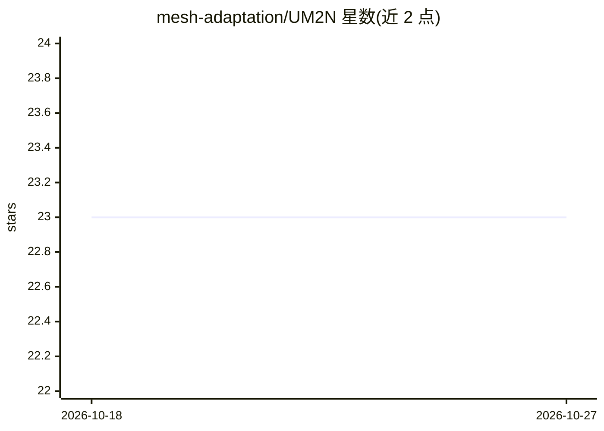

# mesh-adaptation/UM2N

⭐ 23 · Python · MIT · 推送 2026-10-23 · [GitHub](https://github.com/mesh-adaptation/UM2N) · [官网](https://erizmr.github.io/UM2N) · 组织维护

**通用于不同 PDE 的网格移动神经网络（NeurIPS 2024）**

NeurIPS 2024 Spotlight 论文 Toward Universal Mesh Movement Networks 的官方代码库。UM2N 是一个基于学习的网格移动方法：Graph Transformer 编码器提取特征、基于 Graph Attention Network 的解码器移动网格，一次训练后可零样本应用于不同 PDE 类型、边界几何与网格结构。在 advection、Navier-Stokes 及海啸模拟算例上评估。依赖 Firedrake（网格生成）、movement、PyTorch 与 PyTorch3d，提供一键安装脚本（含 CUDA 版）；README 中数据集生成、训练与评估章节标注为过时（outdated）。

## 筛选速览

| 维度 | 判定 | 备注 |
|---|---|---|
| AI 角色 | `ai-native` | 本体是模型或模型工具 |
| 许可风险 | `permissive` | MIT |
| 部署形态 | `library` | 以包/库形式分发 |
| 模型依赖 | — | README 未给出锁定关系 |
| 硬件要求 | — | 无带数字的原话,不猜 |
| 安装摩擦 | `medium` | 含编译或系统依赖之一 |
| 成熟度 | `idea` | |

## 能力要点

- 一次训练后零样本适配不同 PDE 与边界几何的网格移动
- Graph Transformer 编码器 + GAT 解码器架构
- 在 advection、Navier-Stokes 与真实海啸模拟案例上评估
- 提供 Firedrake/PyTorch 一键安装脚本（CPU/CUDA）

## 适用场景

- 科研人员复现论文中的网格自适应实验
- 为 PDE 求解器提供学习型网格移动方法
- 在传统 Monge-Ampère 方法难以处理的复杂边界场景下移动网格

## 场景标签

`科研工具` · 领域:学习与行业

## 证据(README 行号)

> L7:  UM2N(Universal Mesh Movement Networks) performs mesh adaptation for different PDEs and scenarios without re-trainin
> L11: Solving complex Partial Differential Equations (PDEs) accurately and efficiently is an essential and challenging pr

## 星数曲线

2026-10-18 23 → 2026-10-27 23（+0）

---
*卡片 v1 · prompt 1.4 · 生成 2026-10-27 · 置信度 mid · 依据 README sha `37641b3ee0c5` · [字段定义](../../DATASET.md)*
