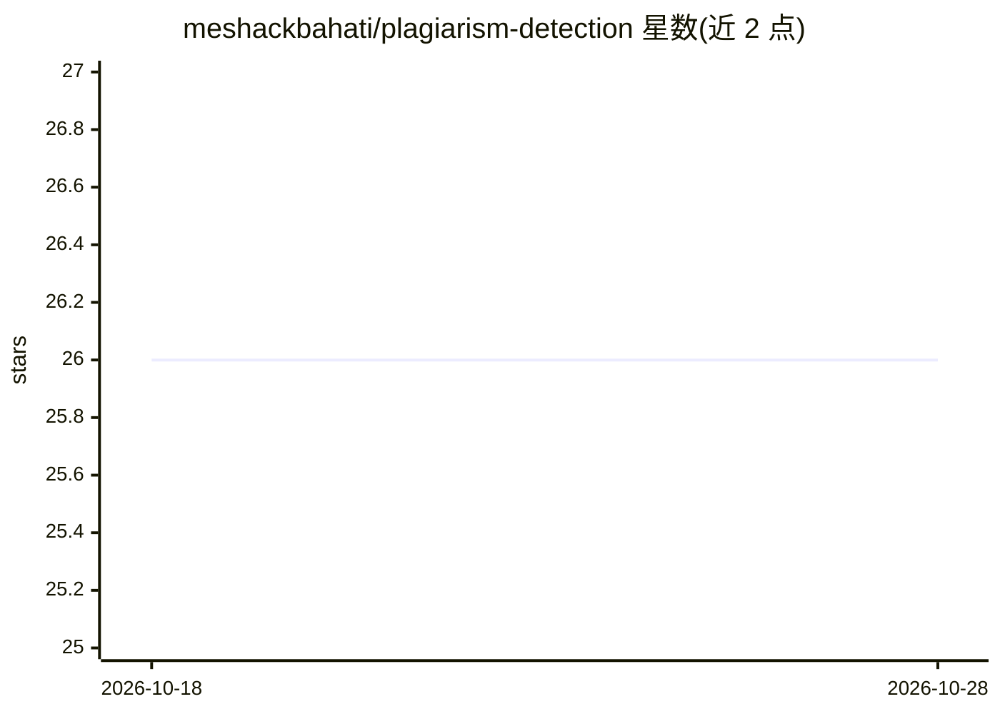

# meshackbahati/plagiarism-detection

⭐ 26 · Python · 推送 2026-06-03 · [GitHub](https://github.com/meshackbahati/plagiarism-detection) · [官网](https://cheataidetector.vercel.app) · 个人维护

**本地部署的文档查重与 AI 生成内容检测工具**

面向需要自有基础设施运行检测流程的用户，提供语义查重（Sentence-BERT 嵌入 + pgvector 跨批次余弦相似度检索）与 AI 内容检测（本地 HuggingFace 分类器 + burstiness 等统计启发式，可选接 OpenAI/Together 外部 API）。支持 PDF/Word/图片（Tesseract OCR）/压缩包批量异步处理（Celery），导出 CSV/PDF 报告。以 Docker Compose 一键部署（FastAPI + React + PostgreSQL/pgvector + Redis + MinIO）；轻量模式可跳过本地模型，最低 1GB 内存，但本地模型基于 GPT-2 输出训练，对现代 LLM 检测精度有限（README 建议改用外部 provider）。

## 筛选速览

| 维度 | 判定 | 备注 |
|---|---|---|
| AI 角色 | `ai-native` | 本体是模型或模型工具 |
| 许可风险 | `none` | — |
| 部署形态 | `self-host` | docker 或自建部署 |
| 模型依赖 | — | README 未给出锁定关系 |
| 硬件要求 | — | 无带数字的原话,不猜 |
| 安装摩擦 | `low` | 无编译、无系统依赖或容器化 |
| 成熟度 | — | 结构信号不足 |

## 能力要点

- Sentence-BERT 嵌入 + pgvector 实现跨批次语义查重
- AI 检测混合方案：本地分类器 + 统计启发式，可选外部 API
- Tesseract OCR 支持扫描 PDF 与图片，压缩包批量处理带路径遍历防护
- 轻量模式跳过本地模型，最低 1GB RAM 可运行

## 适用场景

- 在学校或企业内部对提交文档做查重与 AI 代写检测，数据不出本地
- 批量上传课程作业/稿件，生成 CSV/PDF 检测报告
- 低配服务器上用统计启发式做轻量 AI 内容筛查

## 场景标签

 · 领域:文本检测/教育工具

## 证据(README 行号)

> L7: - **Plagiarism Detection**: Semantic similarity analysis using Sentence-BERT embeddings. Compares documents within a
> L8: - **AI Content Detection**: Hybrid approach combining a local HuggingFace classifier with statistical heuristics (bu

## 星数曲线

2026-10-18 26 → 2026-10-28 26（+0）

---
*卡片 v1 · prompt 1.4 · 生成 2026-10-26 · 置信度 high · 依据 README sha `918e50112677` · [字段定义](../../DATASET.md)*
