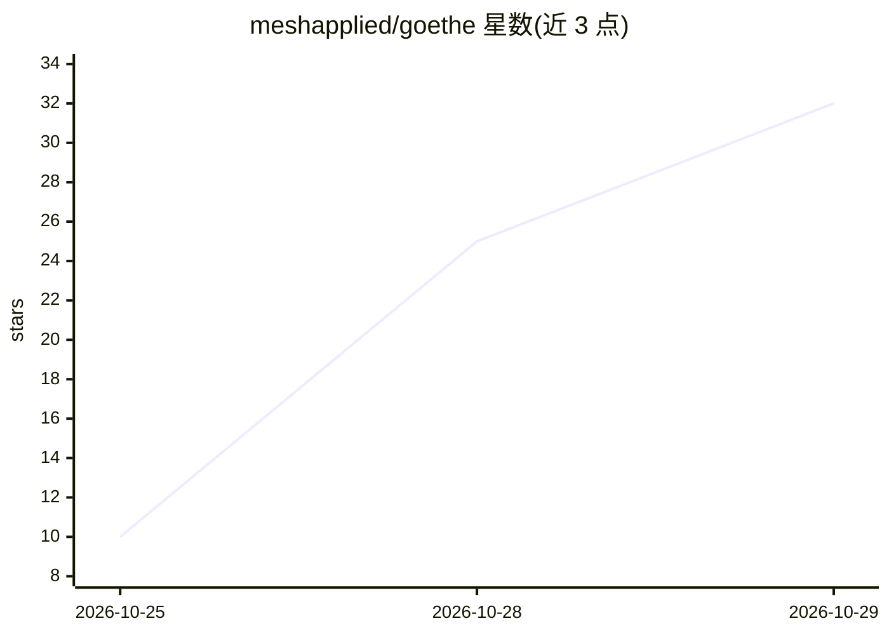

# meshapplied/goethe

⭐ 32 · Rust · Apache-2.0 · 推送 2026-10-27 · [GitHub](https://github.com/meshapplied/goethe) · [官网](https://meshapplied.com) · 组织维护

**自托管 GPU 模型推理服务：把 Linux 机器变成兼容 OpenAI 的 API**

Goethe 是用 Rust 编写的自托管推理服务，将带 NVIDIA GPU 的 Linux 机器（x86_64/aarch64）转变为统一 API 端点，兼容 OpenAI、Anthropic 和 LiteLLM 客户端。三步流程：安装模型、经 API 服务、配置访问权限。支持多模型并行、跨 GPU 切分大模型、API key 的限速/过期/撤销，重启或崩溃后已加载模型自动恢复。自带 CUDA 13 运行时与编译器，仅需 NVIDIA 驱动；支持 Ampere 至 Blackwell 架构 GPU，Volta/Turing 不支持。通过 curl 安装脚本一键安装。

## 筛选速览

| 维度 | 判定 | 备注 |
|---|---|---|
| AI 角色 | `ai-ecosystem` | LLM/agent 周边工具 |
| 许可风险 | `permissive` | Apache-2.0 |
| 部署形态 | `None` |  |
| 模型依赖 | — | README 未给出锁定关系 |
| 硬件要求 | — | 无带数字的原话,不猜 |
| 安装摩擦 | `medium` | 含编译或系统依赖之一 |
| 成熟度 | — | 结构信号不足 |

## 能力要点

- 兼容 OpenAI / Anthropic / LiteLLM 客户端 API，所有模型同一地址
- 多模型并行与跨 GPU 切分，重启后模型自动恢复
- 自带 CUDA 13 运行时与编译器，仅需 NVIDIA 驱动（535+）
- API key 级访问控制：限速、过期、作用域、撤销

## 适用场景

- 在自己的工作站或服务器上托管 LLM 供团队和应用调用
- 通过 Tailscale/WireGuard 等私有网络共享自托管模型 API
- 多块 GPU 上并行运行或切分大模型

## 场景标签

`推理引擎` · 领域:训练与推理

## 证据(README 行号)

> L17: Goethe turns a Linux machine into your own API, compatible with OpenAI, Anthropic and LiteLLM clients. Install it, 
> L44: - **Easy to serve.** Every model you load is served at the same URL; a request picks its model by name.

## 星数曲线

2026-10-25 10 → 2026-10-29 32（+22）

---
*卡片 v1 · prompt 1.4 · 生成 2026-10-28 · 置信度 high · 依据 README sha `b500a9effd70` · [字段定义](../../DATASET.md)*
