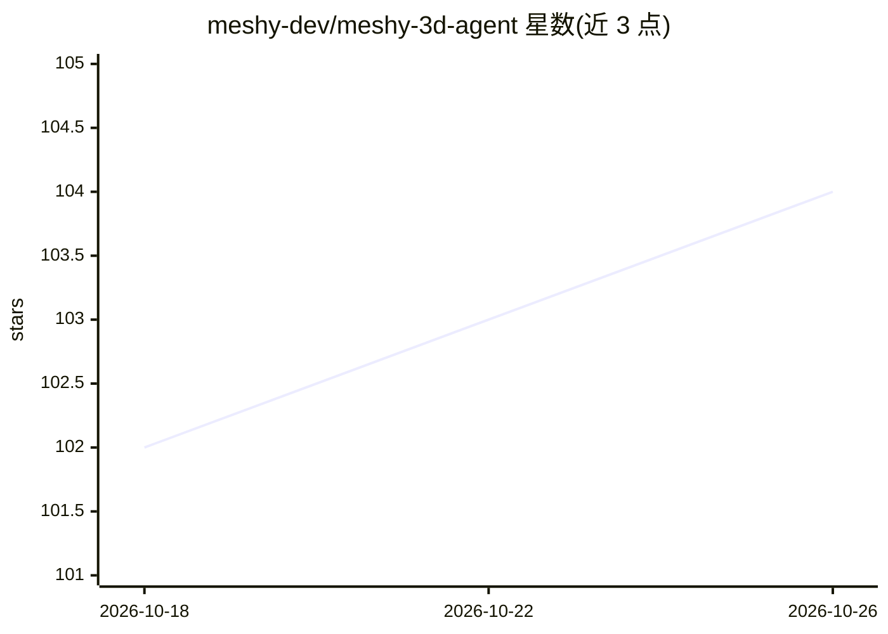

# meshy-dev/meshy-3d-agent

⭐ 104 · JavaScript · MIT · 推送 2026-10-15 · [GitHub](https://github.com/meshy-dev/meshy-3d-agent) · 组织维护

**驱动 Meshy CLI 的 agent 技能包：文生/图生 3D 与 3D 打印工作流**

面向 Claude Code、Codex、Cursor、OpenClaw、Hermes Agent 等 agent 宿主的技能包（0.7.0），以指令与参考文档形式驱动 Meshy CLI 0.4.3（Node.js 22.12+），不捆绑运行时脚本。包含 meshy-3d-generation（文/图/2D/动效生成、纹理、重网格、格式转换、绑定动画）与 meshy-3d-printing（白色模型、多彩 3MF、分析修复、切片器集成）两个技能，另有 OpenClaw 合并版。认证经浏览器 OAuth 登录或 API key，生成需 Meshy 账户额度；本地打印准备无需账户。

## 筛选速览

| 维度 | 判定 | 备注 |
|---|---|---|
| AI 角色 | `ai-ecosystem` | LLM/agent 周边工具 |
| 许可风险 | `permissive` | MIT |
| 部署形态 | `library` | 以包/库形式分发 |
| 模型依赖 | — | README 未给出锁定关系 |
| 硬件要求 | — | 无带数字的原话,不猜 |
| 安装摩擦 | `low` | 无编译、无系统依赖或容器化 |
| 成熟度 | — | 结构信号不足 |

## 能力要点

- 三个技能目录覆盖 3D 生成与 3D 打印两类工作流
- 通过 Meshy CLI 0.4.3 运行，支持 npm exec 临时调用免全局安装
- 浏览器 OAuth 登录，不在聊天中粘贴 API key
- 写入边界限定在指定工作区，路径外（含符号链接）拒绝写入

## 适用场景

- 让 Claude Code/Cursor 等 agent 把照片转成带纹理的 GLB 模型
- 通过对话完成模型格式转换、减面 LOD、缩放到打印尺寸
- 用 agent 做 3MF 多彩打印准备并启动切片器

## 场景标签

 · 领域:3D 生成/agent 工具链

## 证据(README 行号)

> L3: Meshy skills for creating digital assets and preparing 3D prints. All three skills drive
> L4: **Meshy CLI 0.4.3** (`meshy`) on **Node.js 22.12+**. They are instructions and references only —
> L61: |Skill|Workflow|

## 星数曲线

2026-10-18 102 → 2026-10-26 104（+2）

---
*卡片 v1 · prompt 1.4 · 生成 2026-10-23 · 置信度 high · 依据 README sha `dc39284c8818` · [字段定义](../../DATASET.md)*
