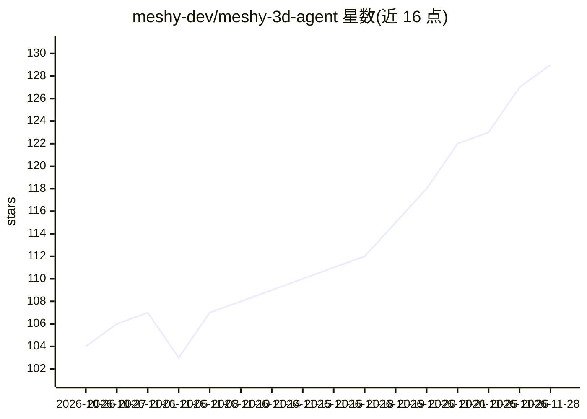

# meshy-dev/meshy-3d-agent

⭐ 129 · JavaScript · MIT · 推送 2026-11-18 · [GitHub](https://github.com/meshy-dev/meshy-3d-agent) · 组织维护

**为 AI agent 提供 Meshy 3D 资产生成与 3D 打印技能集**

包含三个技能目录（3D 生成、3D 打印、OpenClaw 合并技能），以指令与参考文档形式驱动 Meshy CLI 0.8，覆盖文生/图生 3D、纹理、重拓扑、格式转换、UV、绑定动画及白模、多色 3MF、修复与切片器对接。要求 Node.js 22.12+ 与 Meshy Pro 及以上付费计划，生成消耗积分，经浏览器 OAuth 登录，无需 API key；本地打印准备（缩放、切片）不消耗积分。

## 筛选速览

| 维度 | 判定 | 备注 |
|---|---|---|
| AI 角色 | `ai-native` | 本体是模型或模型工具 |
| 许可风险 | `permissive` | MIT |
| 部署形态 | `library` | 以包/库形式分发 |
| 模型依赖 | — | README 未给出锁定关系 |
| 硬件要求 | — | 无带数字的原话,不猜 |
| 安装摩擦 | `low` | 无编译、无系统依赖或容器化 |
| 成熟度 | — | 结构信号不足 |

## 能力要点

- 三个 SKILL.md 格式技能，仅含指令与参考文档，无捆绑运行时脚本
- 浏览器 OAuth 登录，凭据由 OS 密钥环加密存储，技能不读取/打印令牌
- 生成前输出积分估算并在批准预算内执行付费任务
- 支持 Claude Code、Cursor（含插件）、Codex、OpenClaw、Hermes Agent 等宿主

## 适用场景

- 让 agent 把照片转成带纹理的 GLB/FBX 模型
- 从图片或文字生成可用于 3D 打印的白模与多色 3MF
- 在 Cursor 内预览生成的 3D 模型并继续迭代（LOD、缩放、格式转换）

## 场景标签

 · 领域:3D 内容生成/创意工具

## 证据(README 行号)

> L3: Meshy skills for creating digital assets and preparing 3D prints. All three skills drive
> L13: Paste this into Claude Code, Codex, Cursor, OpenClaw, Hermes Agent, Meta Muse or another agent:
> L106: You need Node.js 22.12+ and the paid Meshy plan described at the top of this page. The skills

## 星数曲线

2026-10-26 104 → 2026-11-28 129（+25）

---
*卡片 v1 · prompt 1.4 · 生成 2026-11-28 · 置信度 high · 依据 README sha `9d16598480d6` · [字段定义](../../DATASET.md)*
