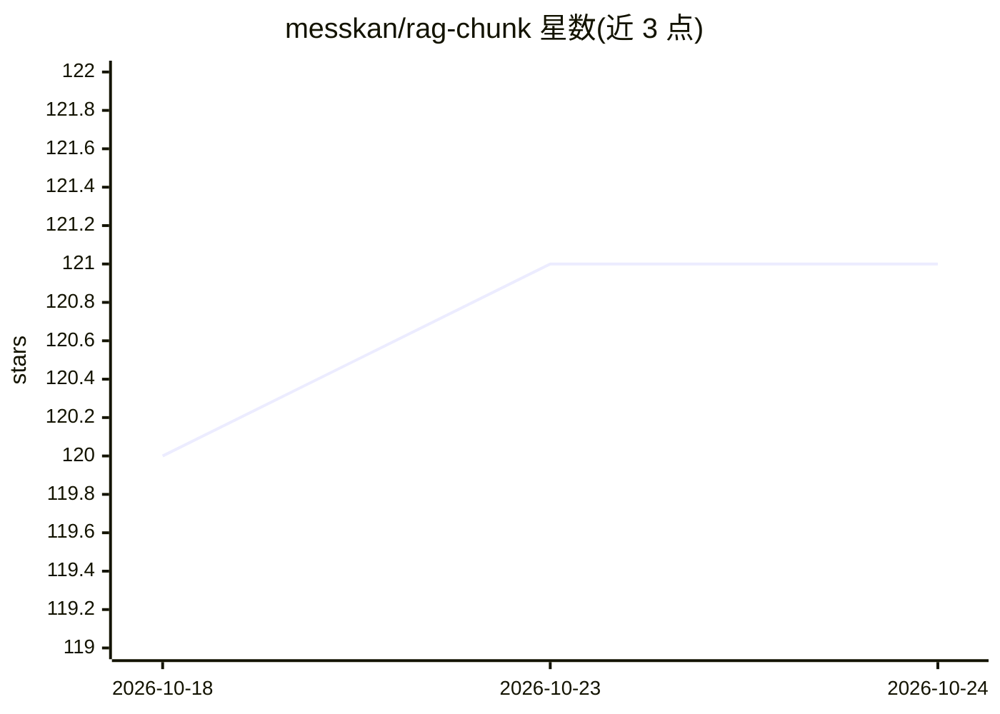

# messkan/rag-chunk

⭐ 121 · Python · MIT · 推送 2026-01-18 · [GitHub](https://github.com/messkan/rag-chunk) · 个人维护

**Markdown 文档 RAG 分块策略的测试与基准 CLI 工具**

Python 命令行工具，面向构建 RAG 管道的开发者：解析并清洗 Markdown（及 .txt）文件，提供 6 种分块策略（fixed-size、sliding-window、paragraph、recursive-character、header、semantic），支持基于 tiktoken 的按 token 分块与 sentence-transformers 嵌入的语义分块/检索；用 JSON 测试问题集计算 Recall/Precision/F1 对比各策略，结果可导出 JSON/CSV，并支持注册自定义分块函数。以 pip 包发布，tiktoken/langchain/semantic 为可选 extras。

## 筛选速览

| 维度 | 判定 | 备注 |
|---|---|---|
| AI 角色 | `ai-ecosystem` | LLM/agent 周边工具 |
| 许可风险 | `permissive` | MIT |
| 部署形态 | `library` | 以包/库形式分发 |
| 模型依赖 | — | README 未给出锁定关系 |
| 硬件要求 | — | 无带数字的原话,不猜 |
| 安装摩擦 | `low` | 无编译、无系统依赖或容器化 |
| 成熟度 | — | 结构信号不足 |

## 能力要点

- 6 种分块策略，可用 --strategy all 一次对比
- 基于 tiktoken 的 token 精确分块（GPT 系列模型）
- 嵌入语义分块与余弦相似度检索（--use-embeddings）
- 用测试问题集计算 Recall/Precision/F1，导出 JSON/CSV

## 适用场景

- 为我的 Markdown 知识库选择召回效果最好的分块策略
- 对比 token 与词计数两种分块粒度的评测结果
- 用自己的问题集基准评测各分块策略的检索表现

## 场景标签

`RAG` `模型评测` · 领域:评测与运维

## 证据(README 行号)

> L5: CLI tool to parse, chunk, and evaluate Markdown documents for Retrieval-Augmented Generation (RAG) pipelines with to
> L24: - 📊 **Advanced Metrics:** Precision, Recall, F1-score evaluation

## 星数曲线

2026-10-18 120 → 2026-10-24 121（+1）

---
*卡片 v1 · prompt 1.4 · 生成 2026-10-23 · 置信度 high · 依据 README sha `a828cb0dfc3e` · [字段定义](../../DATASET.md)*
