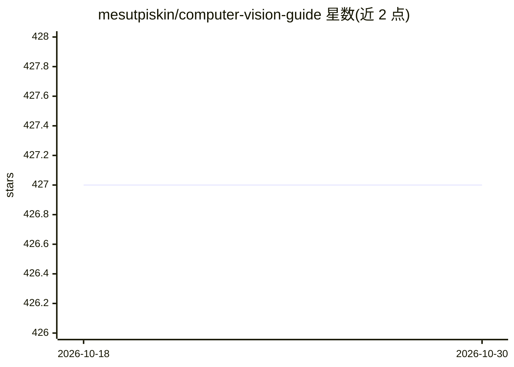

# mesutpiskin/computer-vision-guide

⭐ 427 · Python · NOASSERTION · 推送 2026-05-18 · [GitHub](https://github.com/mesutpiskin/computer-vision-guide) · 个人维护

**土耳其语计算机视觉教程：31 章，从 OpenCV 到 ViT/扩散模型**

面向大学生到软件开发者的土耳其语计算机视觉教程仓库，共 31 章，覆盖 OpenCV 基础、图像处理、特征提取、相机标定、人脸识别、OCR，以及分割、Vision Transformers、生成式扩散模型、3D Vision、视觉语言模型等深度学习主题；技术栈为 Python 3.10+、OpenCV 4.9+、PyTorch、Ultralytics YOLOv8。每章按真实问题→直觉解释→公式→可运行 Python 代码结构组织，示例代码位于 /code 目录，另含 Python/Java/C++/C#/JavaScript 多语言示例项目表。文档以 Markdown 形式提供，无独立安装程序。

## 筛选速览

| 维度 | 判定 | 备注 |
|---|---|---|
| AI 角色 | `ai-knowledge` | 知识聚合/清单类 |
| 许可风险 | `none` | NOASSERTION |
| 部署形态 | `library` | 以包/库形式分发 |
| 模型依赖 | — | README 未给出锁定关系 |
| 硬件要求 | — | 无带数字的原话,不猜 |
| 安装摩擦 | `medium` | 含编译或系统依赖之一 |
| 成熟度 | — | 结构信号不足 |

## 能力要点

- 31 章覆盖 OpenCV 基础到 ViT、扩散模型、3D Vision 与视觉语言模型
- 每章含可运行的 Python 代码示例与多语言示例项目表
- 术语土英对照词典与推荐延伸资源
- 示例要求 Python 3.10+ 与 OpenCV 4.9+

## 适用场景

- 系统学习从图像处理基础到深度学习视觉的完整路径
- 按主题查找可直接复制运行的代码示例
- 查阅 CUDA/OpenVINO/边缘部署等加速与部署方案的做法

## 场景标签

`教程课程` · 领域:学习与行业

## 证据(README 行号)

> L7: # Görüntü İşleme ve Bilgisayarlı Görü Kılavuzu
> L9: OpenCV ve modern derin öğrenme framework'leriyle bilgisayarlı görü uygulamaları geliştirmeye yönelik kapsamlı Türkçe
> L11: Bu kılavuz, üniversite öğrencisinden yazılım geliştiriciye her seviyeye hitap eder. Her konu gerçek dünya problemiy

## 星数曲线

2026-10-18 427 → 2026-10-30 427（+0）

---
*卡片 v1 · prompt 1.4 · 生成 2026-10-21 · 置信度 high · 依据 README sha `18c2d69a9168` · [字段定义](../../DATASET.md)*
