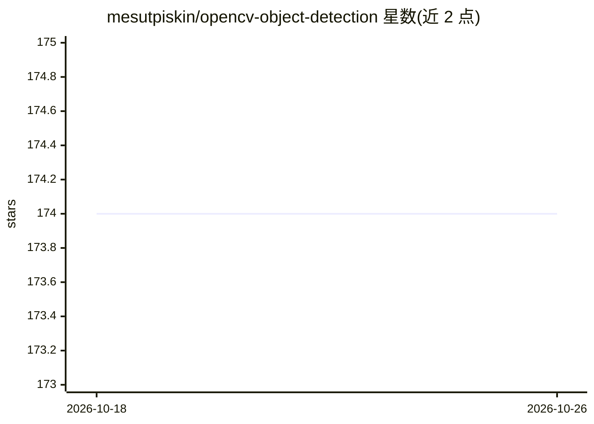

# mesutpiskin/opencv-object-detection

⭐ 174 · Java · MIT · 推送 2026-05-16 · [GitHub](https://github.com/mesutpiskin/opencv-object-detection) · 个人维护

**Java+OpenCV 目标检测示例集：Haar级联/颜色/模板/DNN 四法**

使用 Java 与 OpenCV 实现目标检测的文档化示例项目，含四个示例：Haar 级联分类器检测人脸与眼睛、基于颜色差异的目标检测与跟踪、模板匹配检测、以及 OpenCV DNN 模块加载 MobileNetSSD 训练网络做图像分类。每个示例给出源码位置与依赖要求（OpenCV 2.x/3.x/3.3+、Java 6+），README 提供算法背景说明与博客/视频链接，双语（英/土）呈现。属于教学示例性质，非可安装的库或工具。

## 筛选速览

| 维度 | 判定 | 备注 |
|---|---|---|
| AI 角色 | `ai-native` | 本体是模型或模型工具 |
| 许可风险 | `permissive` | MIT |
| 部署形态 | `None` |  |
| 模型依赖 | — | README 未给出锁定关系 |
| 硬件要求 | — | 无带数字的原话,不猜 |
| 安装摩擦 | `low` | 无编译、无系统依赖或容器化 |
| 成熟度 | — | 结构信号不足 |

## 能力要点

- 四种检测方法示例：Haar 级联、颜色跟踪、模板匹配、DNN
- DNN 示例使用 OpenCV DNN 模块加载 MobileNetSSD 训练网络
- 每个示例标注源码位置与 OpenCV/Java 版本要求

## 适用场景

- 学习 Java 环境下 OpenCV 目标检测的实现方式
- 参考 Haar 级联、模板匹配等经典算法的代码示例
- 了解 OpenCV DNN 模块加载预训练网络的用法

## 场景标签

`目标检测` `教程课程` · 领域:学习与行业

## 证据(README 行号)

> L14: 4. [Deep Learning] - Object detection with deep neural network (DNN).
> L69: In this tutorial you will learn how to use opencv dnn module for image classification by using MobileNetSSD_deploy 

## 星数曲线

2026-10-18 174 → 2026-10-26 174（+0）

---
*卡片 v1 · prompt 1.4 · 生成 2026-10-22 · 置信度 high · 依据 README sha `392d8bd1fd17` · [字段定义](../../DATASET.md)*
