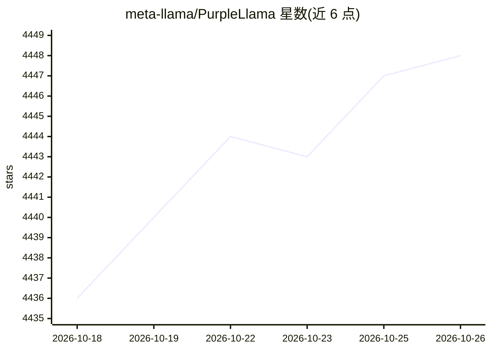

# meta-llama/PurpleLlama

⭐ 4,448 · Python · NOASSERTION · 推送 2026-10-12 · [GitHub](https://github.com/meta-llama/PurpleLlama) · 组织维护

**Meta 的 LLM 安全评估与防护工具集合**

Meta 维护的 LLM 安全伞形项目，包含两类内容：系统级防护组件（Llama Guard 3 输入输出审核模型、Prompt Guard 恶意提示检测、Code Shield 推理时不安全代码过滤）与安全评测基准（CyberSec Eval 1-3，覆盖不安全代码建议、提示注入、钓鱼与进攻性网络能力测试）。面向使用开放生成式 AI 模型的开发与安全团队。各组件采用宽松许可支持研究与商用，入门资源指向 Llama-recipes 仓库，本 README 未给出安装命令。

## 筛选速览

| 维度 | 判定 | 备注 |
|---|---|---|
| AI 角色 | `ai-ecosystem` | LLM/agent 周边工具 |
| 许可风险 | `none` | NOASSERTION |
| 部署形态 | `None` |  |
| 模型依赖 | — | README 未给出锁定关系 |
| 硬件要求 | — | 无带数字的原话,不猜 |
| 安装摩擦 | `low` | 无编译、无系统依赖或容器化 |
| 成熟度 | — | 结构信号不足 |

## 能力要点

- Llama Guard 3 输入/输出审核模型（基于 Llama 3.1/3.2 微调）
- Code Shield 推理时过滤 LLM 生成的不安全代码
- CyberSec Eval 1-3 网络安全评测基准（含提示注入、钓鱼测试）
- 组件以宽松许可支持研究与商业使用

## 适用场景

- 为 LLM 应用的输入输出接入内容审核防护
- 评测 LLM 的网络安全风险与不安全代码倾向
- 在部署含代码解释器的 LLM 系统前做安全评估

## 场景标签

`模型评测` `网络安全` · 领域:评测与运维

## 证据(README 行号)

> L5: Purple Llama is an umbrella project that over time will bring together tools
> L48: ## Evals & Benchmarks

## 星数曲线

2026-10-18 4,436 → 2026-10-26 4,448（+12）

---
*卡片 v1 · prompt 1.4 · 生成 2026-10-20 · 置信度 high · 依据 README sha `1e7a3d80e242` · [字段定义](../../DATASET.md)*
