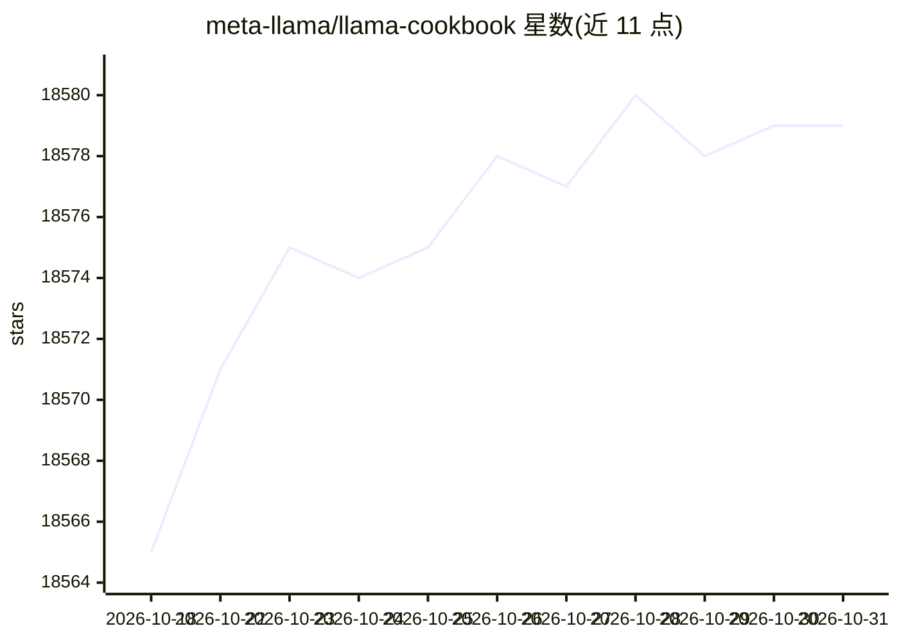

# meta-llama/llama-cookbook

⭐ 18,579 · Jupyter Notebook · MIT · 推送 2026-05-19 · [GitHub](https://github.com/meta-llama/llama-cookbook) · [官网](https://www.llama.com) · 组织维护

**Meta 官方 Llama 模型使用指南：推理、微调、RAG 示例集**

Meta 官方的 Llama 模型家族构建指南仓库，覆盖推理、微调、RAG 入门示例及跨领域端到端用例；包含第三方服务商集成教程（3P Integrations）与 Llama 4 系列新配方（长上下文、WhatsApp 集成、论文分析等）。由 llama-recipes 更名而来，近期做过仓库重构，旧内容归档于 archive-main 分支。以 Python 代码配方形式组织，附微调 FAQ。

## 筛选速览

| 维度 | 判定 | 备注 |
|---|---|---|
| AI 角色 | `ai-ecosystem` | LLM/agent 周边工具 |
| 许可风险 | `permissive` | MIT |
| 部署形态 | `None` |  |
| 模型依赖 | — | README 未给出锁定关系 |
| 硬件要求 | — | 无带数字的原话,不猜 |
| 安装摩擦 | `low` | 无编译、无系统依赖或容器化 |
| 成熟度 | — | 结构信号不足 |

## 动量与使用信号

- 维护:`maintenance` — 距上次 push 151.6 天,年发版 0,125 位贡献者
- 涨星:近 1 天 **+0**(自 20261016 起算)

## 能力要点

- 推理、微调、RAG 三类入门参考配方
- Llama 4 Scout/Maverick 最新示例（5M 长上下文、论文分析等）
- 多家 Llama 服务商的集成与端到端用例
- 保留原 llama-recipes 库源码与微调 FAQ

## 适用场景

- 开始用 Llama 模型做推理或微调时找参考代码
- 在第三方服务商平台上运行 Llama 模型
- 查找文本与视觉模型的端到端应用示例

## 场景标签

`教程课程` `微调` `RAG` · 领域:知识与检索

## 证据(README 行号)

> L12: Welcome to the official repository for helping you get started with inference, fine-tuning and end-to-end use-cases
> L26: - 3P Integrations: Getting Started Recipes and End to End Use-Cases from various Llama providers
> L36:  **A:** We recently renamed llama-recipes to llama-cookbook.

## 星数曲线

2026-10-18 18,565 → 2026-10-31 18,579（+14）

---
*卡片 v1 · prompt 1.4 · 生成 2026-10-18 · 置信度 high · 依据 README sha `efbf01a5fbf9` · [字段定义](../../DATASET.md)*
