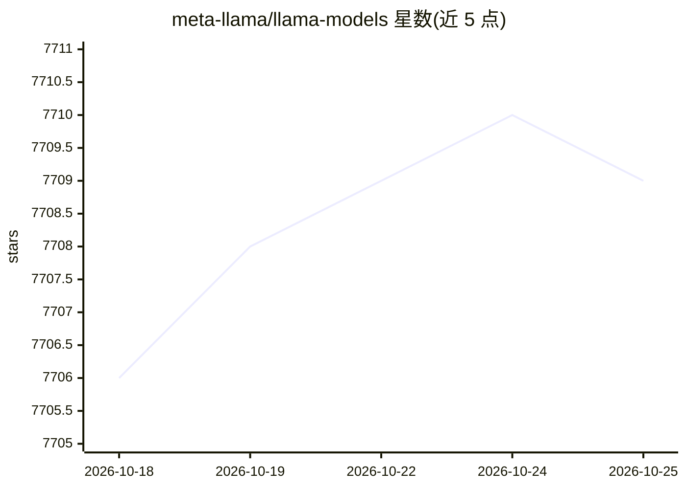

# meta-llama/llama-models

⭐ 7,709 · Python · NOASSERTION · 推送 2026-02-11 · [GitHub](https://github.com/meta-llama/llama-models) · 组织维护

**Meta Llama 模型官方仓库：下载工具与推理脚本**

Meta 官方的 Llama 系列大语言模型仓库，收录 Llama 2 至 Llama 4 各版本（含 Vision 与多尺寸变体）的模型信息、许可证与下载通道。提供 llama-models CLI（pip 安装）通过签名 URL 下载权重与分词器，附 Hugging Face 下载途径；仓库内含 PyTorch 推理脚本，Llama 4 全精度推理需至少 4 GPU，支持 FP8/Int4 量化以降低显存需求。模型权重需接受许可证并经审批后获取，链接 24 小时过期。

## 筛选速览

| 维度 | 判定 | 备注 |
|---|---|---|
| AI 角色 | `ai-native` | 本体是模型或模型工具 |
| 许可风险 | `none` | NOASSERTION |
| 部署形态 | `library` | 以包/库形式分发 |
| 模型依赖 | — | README 未给出锁定关系 |
| 硬件要求 | — | 无带数字的原话,不猜 |
| 安装摩擦 | `low` | 无编译、无系统依赖或容器化 |
| 成熟度 | — | 结构信号不足 |

## 能力要点

- llama-model CLI 列出/描述/下载各版本 Llama 模型权重
- 提供 Llama3/Llama4 推理脚本与 FP8/Int4 量化推理模式
- Llama 4 系列（Scout-17B-16E、Maverick-17B-128E）上下文达 10M/1M
- Hugging Face 提供 transformers 与原生 llama4 两种格式

## 适用场景

- 申请许可证后下载 Llama 模型权重与分词器
- 本地用官方脚本运行 Llama 4 推理（含量化模式）
- 查看各版本 Llama 模型的参数规模、上下文长度与许可证信息

## 场景标签

 · 领域:大模型/LLM

## 证据(README 行号)

> L5: Llama is an accessible, open large language model (LLM) designed for developers, researchers, and businesses to buil
> L34: 4. Install the Llama Models CLI: `pip install llama-models`. (**<-- Start Here if you have received an email alread
> L62: pip install .[torch]

## 星数曲线

2026-10-18 7,706 → 2026-10-25 7,709（+3）

---
*卡片 v1 · prompt 1.4 · 生成 2026-10-20 · 置信度 high · 依据 README sha `37fde12a7d00` · [字段定义](../../DATASET.md)*
