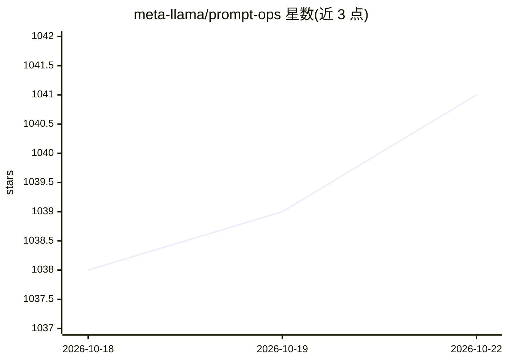

# meta-llama/prompt-ops

⭐ 1,028 · Python · MIT · 推送 2026-04-21 · [GitHub](https://github.com/meta-llama/prompt-ops) · 组织维护

**面向 Llama 模型的 LLM 提示词自动优化 Python 工具**

meta-llama 维护的 Python 包 prompt-ops，将适用于其他 LLM 的系统提示词自动转换为针对 Llama 模型优化的提示词。工作流程：提供现有系统提示词、至少 50 条 query-response 对的 JSON 数据集与 YAML 配置，运行 prompt-ops migrate 单条命令完成优化，输出优化后提示词与前后性能指标对比。通过 LiteLLM 统一 API 客户端调用推理服务，支持 OpenRouter、vLLM、NVIDIA NIM 等提供方；数据格式不符时可扩展 DatasetAdapter 类自定义。新发布 PDO（Prompt Duel Optimizer）论文提出无标签提示词优化方法（arXiv:2510.13907）。MIT 许可。

## 筛选速览

| 维度 | 判定 | 备注 |
|---|---|---|
| AI 角色 | `ai-ecosystem` | LLM/agent 周边工具 |
| 许可风险 | `permissive` | MIT |
| 部署形态 | `library` | 以包/库形式分发 |
| 模型依赖 | local-ok | 支持本地模型 |
| 硬件要求 | — | 无带数字的原话,不猜 |
| 安装摩擦 | `low` | 无编译、无系统依赖或容器化 |
| 成熟度 | `idea` | |

## 能力要点

- 基于模板的提示词优化，单命令 prompt-ops migrate 约 5 分钟完成
- 自带数据集与性能指标，输出优化前后对比
- 通过 LiteLLM 支持多推理提供方（OpenRouter/vLLM/NVIDIA NIM）
- 支持自定义 DatasetAdapter 适配非标准数据格式

## 适用场景

- 把其他 LLM 的系统提示词迁移到 Llama 模型
- 用自有 query-response 数据优化和评估提示词
- 本地 vLLM 或云端 API 部署环境下做提示词优化

## 场景标签

`提示工程` · 领域:Agent 开发

## 证据(README 行号)

> L23: prompt-ops is a Python package that **automatically optimizes prompts** for Llama models. It transforms prompts tha
> L94: prompt-ops uses LiteLLM as a unified API client. LiteLLM automatically detects the provider from your model name (e

## 星数曲线

2026-10-18 1,038 → 2026-10-22 1,041（+3）

---
*卡片 v1 · prompt 1.4 · 生成 2026-10-21 · 置信度 mid · 依据 README sha `d03a8afe281f` · [字段定义](../../DATASET.md)*
