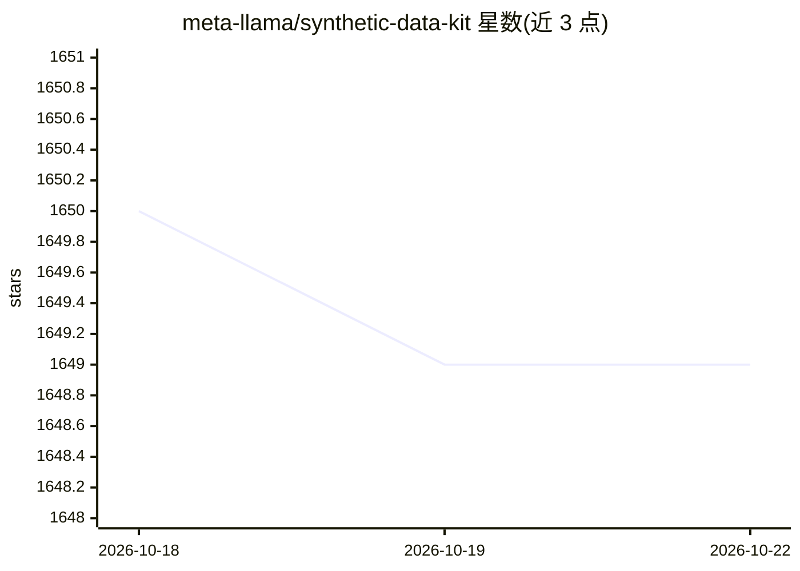

# meta-llama/synthetic-data-kit

⭐ 1,649 · Python · MIT · 推送 2025-10-28 · [GitHub](https://github.com/meta-llama/synthetic-data-kit) · [官网](https://pypi.org/project/synthetic-data-kit/) · 组织维护

**生成合成微调数据集的 CLI 工具，服务 LLM 训练数据准备**

Meta Llama 维护的 Python 命令行工具，用 LLM 后端（vLLM 或任意 API 端点）从 PDF/HTML/DOCX/PPTX/TXT/YouTube 等来源生成 QA 对、带 CoT 的 QA 与摘要，经 Llama-as-judge 筛选后保存为微调格式。四命令流水线（ingest/create/curate/save-as），支持目录批处理、多模态文档、自定义分块（默认 4000 字符、200 重叠）与 YAML/CLI 双重配置；数据默认存为 Lance 格态，可自定义 prompt 模板。面向需要为 Llama 等模型准备训练数据的开发者。

## 筛选速览

| 维度 | 判定 | 备注 |
|---|---|---|
| AI 角色 | `ai-ecosystem` | LLM/agent 周边工具 |
| 许可风险 | `permissive` | MIT |
| 部署形态 | `library` | 以包/库形式分发 |
| 模型依赖 | local-ok | 支持本地模型 |
| 硬件要求 | — | 无带数字的原话,不猜 |
| 安装摩擦 | `medium` | 含编译或系统依赖之一 |
| 成熟度 | — | 结构信号不足 |

## 能力要点

- 四命令流水线：ingest/create/curate/save-as
- QA、CoT QA、摘要三种生成格式，Llama-as-judge 质量筛选
- 支持目录批处理、预览模式与多模态文档抽取
- 文档自动分块（默认 4000 字符、200 重叠）可自定义

## 适用场景

- 把自有文档批量转成可微调的 QA 数据集
- 为领域助手生成带推理链的训练样本
- 微调前用 LLM 评审筛掉低质量样本

## 场景标签

`微调` `文档解析` · 领域:知识与检索

## 证据(README 行号)

> L3: Tool for generating high-quality synthetic datasets to fine-tune LLMs.
> L19: - Using a LLM (vLLM or any local/external API endpoint) to generate examples
> L31: - `curate`: Using Llama as a judge to curate high quality examples.

## 星数曲线

2026-10-18 1,650 → 2026-10-22 1,649（-1）

---
*卡片 v1 · prompt 1.4 · 生成 2026-10-21 · 置信度 high · 依据 README sha `9549e5ed7284` · [字段定义](../../DATASET.md)*
