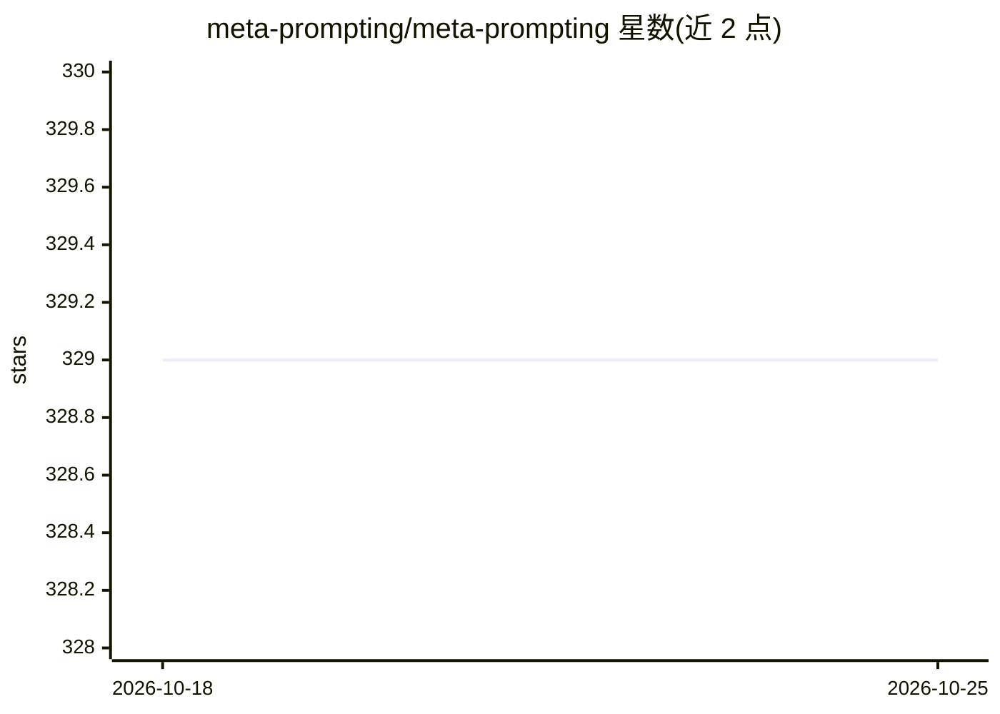

# meta-prompting/meta-prompting

⭐ 329 · Python · MIT · 推送 2026-08-02 · [GitHub](https://github.com/meta-prompting/meta-prompting) · [官网](https://meta-prompting.github.io) · 组织维护

**论文官方实现：提供元提示（Meta Prompting）提示模板与在线演示**

《Meta Prompting for AI Systems》论文（arXiv:2311.11482，张亦弛、姚顺雨署名）的官方仓库。提出以任务形式结构而非具体示例的元提示方法：用单一示例无关的提示引导 LLM 推理，并用范畴论（函子）形式化，扩展为 LLM 自我生成与改进提示的递归元提示（用 monad 形式化）。实验以 Qwen-72B 基座模型在 MATH（46.3%）、GSM8K（83.5%）、Game of 24（100%）上报告结果。仓库主要提供 /prompts 目录中的论文提示词，供复现或改造为系统提示，另有三个 Custom GPT 在线演示；未提供本仓库代码的安装运行说明，标注 Python 3.9+。

## 筛选速览

| 维度 | 判定 | 备注 |
|---|---|---|
| AI 角色 | `ai-knowledge` | 知识聚合/清单类 |
| 许可风险 | `permissive` | MIT |
| 部署形态 | `None` |  |
| 模型依赖 | — | README 未给出锁定关系 |
| 硬件要求 | — | 无带数字的原话,不猜 |
| 安装摩擦 | `low` | 无编译、无系统依赖或容器化 |
| 成熟度 | — | 结构信号不足 |

## 能力要点

- 元提示：示例无关的结构化提示模板，不依赖 few-shot 示例
- 递归元提示（RMP）：LLM 自动生成并改进自身提示的自我改进过程
- 仓库提供论文所用提示词（/prompts 目录）可直接用作系统提示
- 提供三个 Custom GPT 在线演示（复杂推理/提示修订/递归提示设计）

## 适用场景

- 复现论文在 MATH/GSM8K/Game of 24 上的实验
- 把元提示模板用作系统提示提升基座模型推理
- 在线试用各版本的 Meta Prompting agent

## 场景标签

`提示工程` · 领域:Agent 开发

## 证据(README 行号)

> L9: This is the official repo for the paper **"Meta Prompting for AI Systems"** (https://arxiv.org/abs/2311.11482).
> L132: The prompts used in our paper are available in the `/prompts` directory. You can use them as system prompts for LL

## 星数曲线

2026-10-18 329 → 2026-10-25 329（+0）

---
*卡片 v1 · prompt 1.4 · 生成 2026-10-22 · 置信度 high · 依据 README sha `ddc02b8124d7` · [字段定义](../../DATASET.md)*
