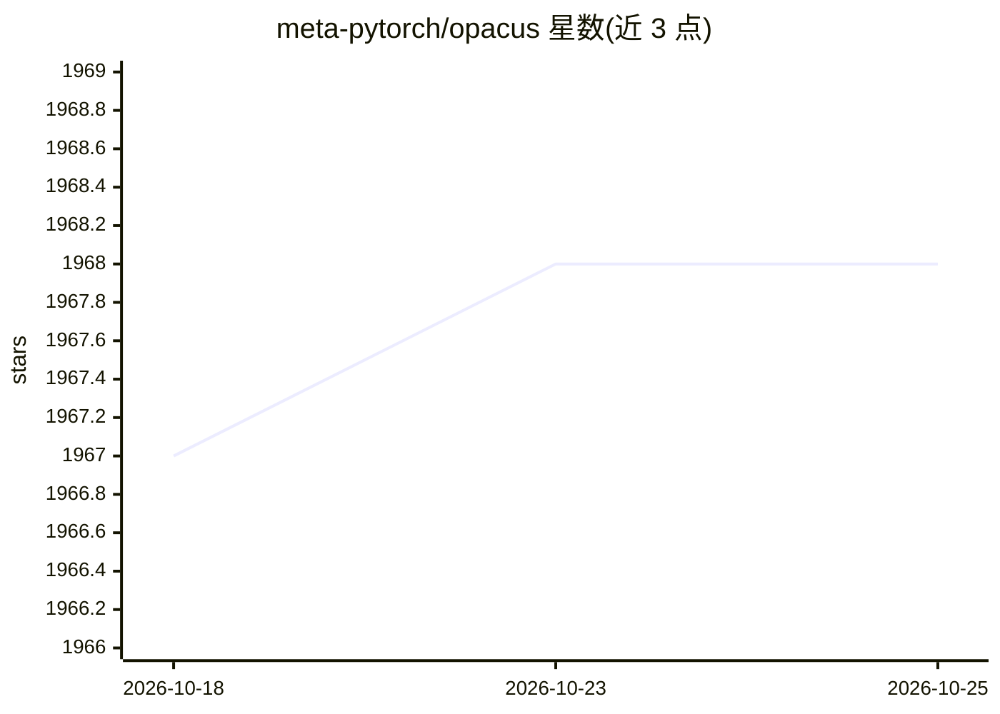

# meta-pytorch/opacus

⭐ 1,968 · Python · Apache-2.0 · 推送 2026-09-24 · [GitHub](https://github.com/meta-pytorch/opacus) · [官网](https://opacus.ai) · 组织维护

**PyTorch 差分隐私训练库：最少代码改动实现 DP-SGD**

Opacus 是用于以差分隐私方式训练 PyTorch 模型的库：实例化 PrivacyEngine 并调用 make_private() 即可将模型、数据加载器与优化器转为隐私对应版本，代码改动少，并可在线跟踪已消耗的隐私预算。面向 ML 从业者与差分隐私研究者两类用户。支持 Fast Gradient Clipping 与 Ghost Clipping 以降低 DP-SGD 显存占用，可与 LoRA/peft 结合使用。通过 pip/conda 安装，也可从源码安装，提供 MNIST 端到端示例与 IPython 交互教程。

## 筛选速览

| 维度 | 判定 | 备注 |
|---|---|---|
| AI 角色 | `ai-ecosystem` | LLM/agent 周边工具 |
| 许可风险 | `permissive` | Apache-2.0 |
| 部署形态 | `library` | 以包/库形式分发 |
| 模型依赖 | — | README 未给出锁定关系 |
| 硬件要求 | — | 无带数字的原话,不猜 |
| 安装摩擦 | `low` | 无编译、无系统依赖或容器化 |
| 成熟度 | — | 结构信号不足 |

## 能力要点

- PrivacyEngine.make_private() 以最少代码改动实现差分隐私训练
- 在线跟踪隐私预算消耗
- Fast Gradient Clipping 与 Ghost Clipping 降低 DP-SGD 内存需求
- 支持与 LoRA/peft 库结合的 DP-SGD 训练

## 适用场景

- 在 PyTorch 训练流程中加入差分隐私保护
- 实验和调试不同的差分隐私训练方法
- 跟踪训练过程中的隐私预算消耗

## 场景标签

 · 领域:机器学习/隐私计算

## 证据(README 行号)

> L11: Opacus is a library that enables training PyTorch models
> L12: with differential privacy. It supports training with minimal code changes

## 星数曲线

2026-10-18 1,967 → 2026-10-25 1,968（+1）

---
*卡片 v1 · prompt 1.4 · 生成 2026-10-21 · 置信度 high · 依据 README sha `a4d29e42cdbb` · [字段定义](../../DATASET.md)*
