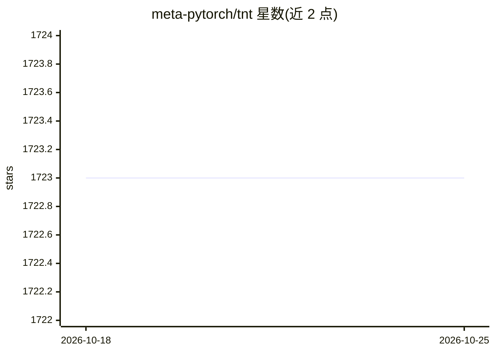

# meta-pytorch/tnt

⭐ 1,723 · Python · NOASSERTION · 推送 2026-10-19 · [GitHub](https://github.com/meta-pytorch/tnt) · [官网](https://pytorch.org/tnt/) · 组织维护

**PyTorch 训练工具与实用程序轻量库**

TNT（torchtnt）是面向 PyTorch 的训练工具与实用程序库，提供训练流程相关组件，服务于使用 PyTorch 进行深度学习与强化学习开发的研究者和工程师。安装支持 pip、conda（conda-forge 频道）以及从 GitHub master 源码安装；安装时需确保 PyTorch 已先行安装。项目采用 BSD 许可证，提供 nightly 版本与 codecov、文档等工程配套。

## 筛选速览

| 维度 | 判定 | 备注 |
|---|---|---|
| AI 角色 | `ai-ecosystem` | LLM/agent 周边工具 |
| 许可风险 | `none` | NOASSERTION |
| 部署形态 | `library` | 以包/库形式分发 |
| 模型依赖 | — | README 未给出锁定关系 |
| 硬件要求 | — | 无带数字的原话,不猜 |
| 安装摩擦 | `low` | 无编译、无系统依赖或容器化 |
| 成熟度 | — | 结构信号不足 |

## 能力要点

- 面向 PyTorch 的训练工具与实用程序集合
- 支持 pip / conda / 源码三种安装方式
- 提供 nightly 版本发布

## 适用场景

- PyTorch 项目中组织训练循环与训练工具
- 需要轻量级训练实用程序库的深度学习开发
- 强化学习实验的训练流程搭建

## 场景标签

`模型训练` · 领域:训练与推理

## 证据(README 行号)

> L3: **TNT** is a library for PyTorch **t**rai**n**ing **t**ools and utilities.
> L26: If you run into issues, make sure that Pytorch is installed first.

## 星数曲线

2026-10-18 1,723 → 2026-10-25 1,723（+0）

---
*卡片 v1 · prompt 1.4 · 生成 2026-10-21 · 置信度 high · 依据 README sha `818bef808e9b` · [字段定义](../../DATASET.md)*
