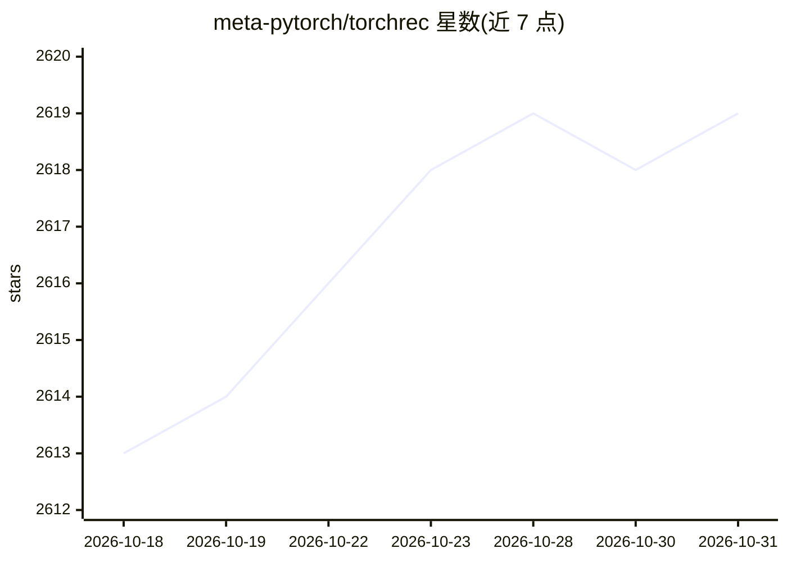

# meta-pytorch/torchrec

⭐ 2,619 · Python · BSD-3-Clause · 推送 2026-10-30 · [GitHub](https://github.com/meta-pytorch/torchrec) · [官网](https://pytorch.org/torchrec/) · 组织维护

**面向大规模推荐系统的 PyTorch 领域库**

Meta 维护的 PyTorch 领域库，提供大规模推荐系统（RecSys）所需的稀疏性与并行化原语：支持将大型嵌入表按多种策略（table-wise/row-wise/column-wise 等）分片到多 GPU/多节点，含自动生成分片计划的 Planner、流水线化训练、基于 FBGEMM 的优化内核、量化训练与推理、criteo/movielens 数据集及 DLRM 端到端训练示例。面向构建生产级推荐模型的开发者。

## 筛选速览

| 维度 | 判定 | 备注 |
|---|---|---|
| AI 角色 | `ai-ecosystem` | LLM/agent 周边工具 |
| 许可风险 | `permissive` | BSD-3-Clause |
| 部署形态 | `library` | 以包/库形式分发 |
| 模型依赖 | — | README 未给出锁定关系 |
| 硬件要求 | — | 无带数字的原话,不猜 |
| 安装摩擦 | `medium` | 含编译或系统依赖之一 |
| 成熟度 | — | 结构信号不足 |

## 能力要点

- 嵌入表多策略分片与混合数据/模型并行原语
- 自动生成优化分片计划的 Planner
- FBGEMM 优化内核与量化训练/推理支持
- 内置 criteo/movielens 数据集与 DLRM 端到端训练示例

## 适用场景

- 训练跨多 GPU/多节点的大型嵌入表推荐模型
- 构建生产级 DLRM 类推荐模型
- 对推荐模型做量化与 C++ 推理优化

## 场景标签

`推荐系统` · 领域:学习与行业

## 证据(README 行号)

> L3: **TorchRec** is a PyTorch domain library built to provide common sparsity and parallelism primitives needed for larg
> L20: - Parallelism primitives that enable easy authoring of large, performant multi-device/multi-node models using hybri

## 星数曲线

2026-10-18 2,613 → 2026-10-31 2,619（+6）

---
*卡片 v1 · prompt 1.4 · 生成 2026-10-21 · 置信度 mid · 依据 README sha `b59a06593988` · [字段定义](../../DATASET.md)*
