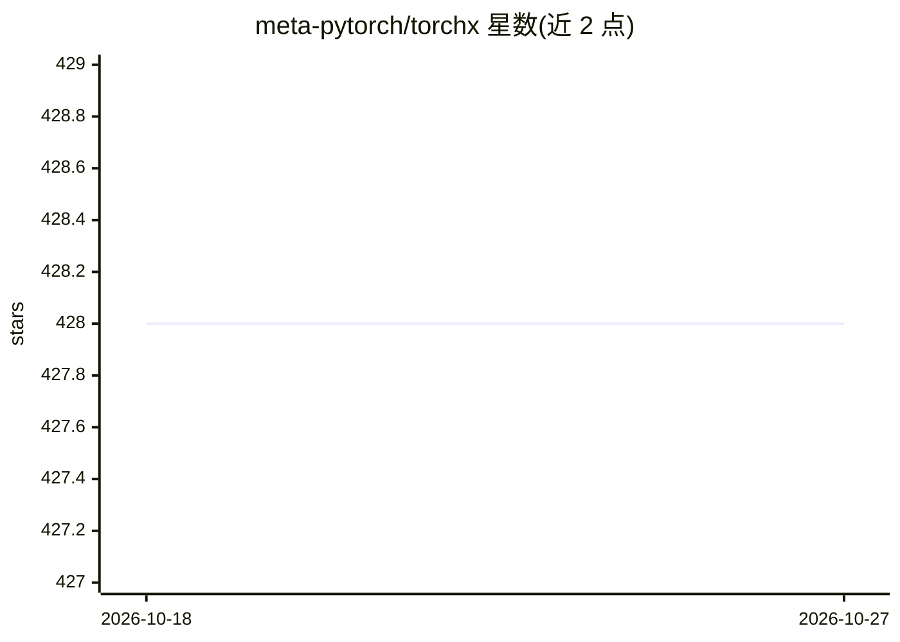

# meta-pytorch/torchx

⭐ 428 · Python · NOASSERTION · 推送 2026-10-20 · [GitHub](https://github.com/meta-pytorch/torchx) · [官网](https://pytorch.org/torchx) · 组织维护

**面向 PyTorch 应用的通用作业启动器，覆盖训练到生产管线**

Meta/PyTorch 团队维护的 PyTorch 应用通用作业启动器：将训练与研究脚本以组件方式定义并提交到多种调度后端，当前支持 Kubernetes（EKS/GKE/AKS 等）、Slurm、Docker 与本地运行。定位为快速迭代的训练/研究工具，同时支持端到端生产 ML 管线。要求 python3 3.8+ 与 PyTorch，Docker 为可选依赖（用于 docker 类调度器）；通过 pip 安装 stable/nightly 版本，或从源码构建，另在 ghcr.io 提供 Docker 镜像作为 TorchX role 使用。

## 筛选速览

| 维度 | 判定 | 备注 |
|---|---|---|
| AI 角色 | `ai-ecosystem` | LLM/agent 周边工具 |
| 许可风险 | `none` | NOASSERTION |
| 部署形态 | `library` | 以包/库形式分发 |
| 模型依赖 | — | README 未给出锁定关系 |
| 硬件要求 | — | 无带数字的原话,不猜 |
| 安装摩擦 | `low` | 无编译、无系统依赖或容器化 |
| 成熟度 | — | 结构信号不足 |

## 能力要点

- 统一接口向 Kubernetes/Slurm/Docker/本地提交 PyTorch 作业
- 组件（components）方式定义可复用作业
- 兼顾研究快速迭代与端到端生产 ML 管线
- 提供 ghcr.io/pytorch/torchx Docker 容器镜像

## 适用场景

- 在 Slurm 或 Kubernetes 集群上启动分布式训练作业
- 本地快速迭代后无缝迁移到生产调度环境
- 以组件化方式复用和编排 ML 管线

## 场景标签

`MLOps` · 领域:训练与推理

## 证据(README 行号)

> L9: TorchX is a universal job launcher for PyTorch applications.
> L11: for E2E production ML pipelines when you're ready.

## 星数曲线

2026-10-18 428 → 2026-10-27 428（+0）

---
*卡片 v1 · prompt 1.4 · 生成 2026-10-21 · 置信度 high · 依据 README sha `33ac6b713ada` · [字段定义](../../DATASET.md)*
